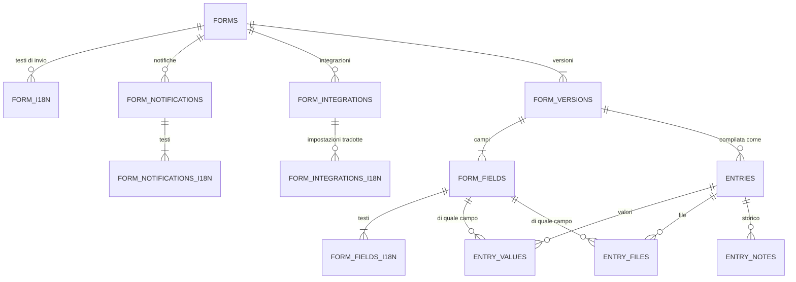

# Barrio Suite: piano di sviluppo (modulo Forms)

Riscrittura da zero del modulo Forms di `suite-barrio-prototipo`. Del prototipo si conservano le
funzionalità, non il codice. Il plugin nasce con il solo modulo Forms; gli altri moduli
arriveranno uno alla volta con la stessa struttura.

## Decisioni prese

| Tema | Decisione |
|---|---|
| Nome | `barrio-suite`, namespace `BarrioSuite\`, prefisso `barrio_`, tabelle `{prefix}barrio_*` |
| Convivenza | Gira accanto al prototipo (nessuna tabella, opzione o shortcode in comune) finché i siti non sono migrati. Sul prototipo va disattivato il modulo Forms |
| Requisiti | PHP 8.2+, WordPress 6.9+, MySQL 8.0.16+ o MariaDB 10.5+, InnoDB. Controllati all'attivazione con un messaggio chiaro |
| Database | Il centro del progetto: foreign key reali, CHECK, migrazioni versionate (vedi §2) |
| Email | `wp_mail()`, che usa il PHPMailer incluso in WordPress, con l'SMTP configurato tramite `phpmailer_init` e applicato a **tutte** le email del sito |
| Admin | Un'app React (`@wordpress/scripts`) per le pagine del menu Barrio, Bacheca, Form (schede Form, Registrazioni e Impostazioni), Estensioni e Impostazioni del plugin, con intestazione (l'icona del prototipo, nome, descrizione); componenti di base in HTML nativo con un CSS del plugin (card, bottoni scuri), da `@wordpress/components` solo modale, popover e schede del builder |
| Tabelle | **Regola fissa per tutte le tabelle del plugin**, con lo stesso componente `Table`: nella barra ricerca, un solo pulsante Filtri e, con righe selezionate, il menu "N selezionate" delle azioni di massa; poi l'azione principale (Nuovo form, Esporta CSV). Il pannello Filtri ha una sezione per filtro (lo stato sempre, se le righe ne hanno uno, con i conteggi; la lingua; con la ricerca oltre 5 scelte) e le colonne da mostrare; sul pulsante il numero dei filtri attivi, in fondo "Clear filters" che riporta all'inizio filtri, colonne, ordinamento e ricerca. Le altre scelte singole (il form delle registrazioni, la lingua del builder) usano lo stesso `Picker`. Selezione multipla con la prima colonna. Paginazione (20 righe) e ordinamento a tre stati (crescente → decrescente → ordine di default), con una colonna sempre ordinata (all'inizio quella di default, con la sua freccia); le azioni di riga stanno tutte in un menu "⋯". Menu e scelte oltre 5 voci hanno la ricerca; bottoni e campi hanno lo stesso bordo |
| Pagine con salvataggio | Ogni pagina ha una barra sticky in alto (`Bar`), staccata di 16px da quella di WordPress e sempre con lo stesso schema: titolo a sinistra (con il ritorno, se c'è), azioni a destra con la principale per ultima, scura e con icona. Salva (attivo solo con modifiche) sostituisce i pulsanti per sezione; fa eccezione la Bacheca, che non ha azioni sue (gli avvisi di WordPress stanno sopra l'intestazione); negli elenchi la barra ha la ricerca e "Nuovo". Avviso prima di lasciare la pagina con modifiche. Le anteprime (form, email) sono alte quanto il contenuto: scorre solo il modale. Ogni modale è `Dialog` di `ui.js` (mai `Modal` direttamente): l'intestazione resta in alto con la linea sotto sempre visibile, i bottoni stanno in un piede sempre visibile in fondo mentre il contenuto scorre, e i campi hanno gli stili delle pagine. Negli elenchi "Aggiungi…" sta sempre nell'intestazione della sezione, a destra. La barra resta su una riga: se non ci sta, prima lo shortcode del builder si accorcia con i puntini (fino a 120px), poi i pulsanti perdono il testo (il nome del form si accorcia, la lingua del builder resta con la sola bandiera), poi la ricerca diventa un pulsante; solo come ultima risorsa il titolo va sopra (`fit()` in `ui.js`). La colonna destra, quando c'è, è sticky. Sui telefoni niente esce dalla pagina: le tabelle scorrono in orizzontale con le colonne alla loro larghezza |
| Spazi e controlli | Spazi e misure a multipli di 4 (`admin.css`): 20px tra le card e dentro, 16px tra i campi; lo spazio dentro un elemento non supera quello che lo separa dagli altri, e un angolo dentro un altro ha il raggio di quello esterno meno la distanza dal bordo (card e barra 16px, controlli 8px). Per acceso/spento un interruttore (`Toggle`), con il testo a sinistra; le caselle restano per scegliere da un elenco (righe della tabella, colonne, opzioni) e nell'anteprima dei campi del form. Ciò che si allunga si chiude: le notifiche e le integrazioni di un form sono card richiudibili (chiuse se sono più d'una, aperta quella appena aggiunta), e le impostazioni rare stanno in una sezione chiusa (`Details`: Avanzate del campo, l'email di prova) |
| GraphQL | Estensione separata `barrio-suite-wpgraphql` (fase 9), come WPML: il core non contiene codice per WPGraphQL. Nomi invariati: `hbForm`, `hbForms`, `hbSubmitForm` e tutti i tipi `HB*`/`Hb*` |
| Plugin esterni | Nessuno è obbligatorio: senza WPGraphQL o WPML il plugin funziona e disattiva solo le funzioni che dipendono da loro (§4.1). Il core non contiene codice per plugin di terzi: ognuno si collega con un'estensione (`barrio-suite-wpml`, `barrio-suite-wpgraphql`), così passare a un altro plugin non lascia codice inutilizzato |
| Traduzioni | Editor interno; le traduzioni si salvano nel database dentro ogni versione del form. Le lingue disponibili vengono dai filtri `barrio_languages`, `barrio_current_language`, `barrio_locale` e `barrio_language_flags` (del core, per tutti i moduli), a cui risponde un'estensione (`barrio-suite-wpml`); senza estensione il plugin lavora nella lingua del sito. Nel builder la lingua si sceglie nella barra: nelle altre lingue si modificano solo i testi, e uno vuoto è quello della lingua principale |
| ACF | Il plugin non usa ACF |
| Privacy | Privacy by design e by default (art. 25 GDPR) in tutto il plugin: si raccoglie e si salva solo ciò che serve al form; ogni raccolta in più è un'opzione disattivata di default |
| Estensioni | Plugin separati (Mailchimp, MailUp, reCAPTCHA/Turnstile…) che usano hook e registri del core (`docs/hooks.md`). Anche la migrazione dal prototipo è un'estensione: il core non contiene codice di compatibilità con il prototipo. Il captcha è reCAPTCHA Enterprise v3 come nel prototipo, così i siti tengono le loro credenziali; Turnstile sarebbe un'altra estensione con gli stessi hook. La pagina Barrio → Extensions le installa; da dove vengono e come si aggiornano dipende dal branch: release GitHub in `con-updater`, directory di WordPress.org in `senza-updater` (`docs/release.md`) |

Principi: leggibilità prima dell'astuzia; ogni astrazione deve servire a qualcosa oggi; riusare
WordPress, WPGraphQL e WPML prima di scrivere codice nostro; una sola persona deve poter
mantenere tutto.

---

## 1. Problemi del prototipo da non ripetere

| Problema | Conseguenza |
|---|---|
| **`hbSubmitForm` salva in `/uploads` file in base64 con il nome scelto da chi invia, senza alcun controllo sull'estensione** | Chiunque, senza autenticazione, può caricare un file `.php` in una cartella pubblica (*remote code execution* sugli hosting che eseguono PHP in `/uploads`) |
| Logica di invio scritta due volte (AJAX e GraphQL) | Comportamenti diversi; la versione GraphQL non ha antispam |
| Campo obbligatorio controllato sul server senza la logica condizionale | Un campo obbligatorio nascosto blocca l'invio del form |
| Nonce scritto nell'HTML della pagina | Con una cache di pagina il nonce scade e l'invio fallisce |
| `$allowed_types` dichiarata ma mai usata; file in `/uploads` pubblico | Dati personali raggiungibili da un URL prevedibile |
| `page_break` ignorato dal frontend classico | Il multistep funziona solo in headless |
| `CREATE TABLE` e `SHOW COLUMNS` su `plugins_loaded` | Tre query DDL a **ogni** richiesta |
| CSS e JS inline generati da PHP | Non vanno in cache, non si possono testare |
| Integrazioni scritte dentro l'handler di invio | Per estendere bisogna modificare il core |
| Valori delle checkbox salvati come `"Label: true \| Label: false"` | Per leggerli serve una regex; le statistiche sono impossibili |
| Ogni registrazione salva il testo tradotto delle opzioni | La stessa scelta in due lingue risulta come due valori diversi |

---

## 2. Database (la fase più curata)

### 2.1 Regole di progettazione

1. **Motore e charset**: InnoDB esplicito; charset e collation di WordPress (`$wpdb->get_charset_collate()`, utf8mb4).
2. **Chiavi**: primary key surrogate `BIGINT UNSIGNED AUTO_INCREMENT` per le entità; primary key composta per le tabelle figlie pure (valori, traduzioni).
3. **Date**: `DATETIME` in **UTC**, scritte sempre da PHP (`gmdate()`). Niente `DEFAULT CURRENT_TIMESTAMP`, che dipende dal fuso della sessione MySQL. In visualizzazione si converte con `wp_date()`.
4. **Colonne o JSON**: una colonna per tutto ciò che il database deve interrogare, indicizzare o vincolare. Il tipo `JSON` (con CHECK che sia un oggetto) solo per la configurazione che si legge e si scrive sempre in blocco. Quel JSON viene validato in PHP con il JSON Schema di WordPress (`rest_validate_value_from_schema()`) prima di ogni scrittura.
5. **Foreign key sempre.** `CASCADE` solo verso figli puri senza risorse esterne; `RESTRICT` dove c'è un file su disco o un dato storico (le registrazioni). Così il database impedisce di cancellare una registrazione con file, o un form con registrazioni, senza passare dal codice del plugin.
6. **Nomi dei vincoli con il prefisso delle tabelle** (`{prefix}bff_version_fk`): in MySQL i nomi dei vincoli sono unici per database, quindi due installazioni WordPress nello stesso DB andrebbero in conflitto. Massimo 64 caratteri.
7. **CHECK per gli insiemi chiusi** (stati, flag, formati). WordPress disattiva la modalità rigorosa di MySQL, quindi senza CHECK un valore non valido verrebbe salvato senza errori. Gli insiemi aperti, come il tipo di campo che le estensioni possono ampliare, si validano in PHP.
8. **NULL significa "non applicabile o non noto".** Niente stringhe vuote usate come segnaposto.
9. **Nessuna foreign key verso le tabelle core di WordPress**: possono essere MyISAM sui siti vecchi e WordPress non conosce i nostri vincoli. `entry_notes.user_id` diventa NULL tramite l'hook `deleted_user`.
10. **Un solo punto di accesso**: solo i Repository usano `$wpdb`. Query sempre preparate (`%i` per gli identificatori). Ogni scrittura su più tabelle avviene in transazione.
11. **Registrazioni immutabili**: dopo l'invio cambiano solo `is_read` e le note.
12. **Migrazioni numerate**, solo in avanti, idempotenti e protette da un lock. Mai `dbDelta`, che non gestisce FOREIGN KEY e CHECK e non sa migrare i dati.

Ogni insieme chiuso esiste due volte, con gli stessi valori: come CHECK nel database e come
`enum` PHP (per esempio `FormStatus`). I test verificano che coincidano.

### 2.2 Modello

Concetto chiave: **versioni immutabili di ciò che il visitatore legge prima di inviare**, cioè i
campi e i loro testi. Ogni salvataggio dal builder crea una nuova versione dei campi. Ogni registrazione punta alla versione che l'utente
ha compilato. Nello stesso salvataggio la versione precedente viene eliminata se nessuna
registrazione la usa, quindi in pratica si accumulano versioni solo per i form modificati
dopo aver ricevuto risposte. Si ottiene:

- **Storia fedele**: etichette, opzioni e testo del consenso (anche tradotti) restano esattamente come li ha visti chi ha compilato. Vale come prova del consenso GDPR.
- **Nessun soft delete né diff dei campi**: un salvataggio inserisce righe nuove, non ne modifica di vecchie.
- **Blocco ottimistico gratuito**: il builder invia `base_version`. Se nel frattempo qualcuno ha salvato, la risposta è `409 Conflict` invece di sovrascrivere.

Testi di invio e di conferma e notifiche non si versionano: il visitatore vede i primi dopo l'invio,
e il rinvio di una notifica deve usare la configurazione corretta, non quella di allora. Si
sostituiscono a ogni salvataggio. Tutti i testi stanno in tabelle `_i18n` con una riga per lingua,
compresa la principale: nessun testo ha una lingua implicita.

`field_key` (per esempio `email`) è l'identità stabile di un campo **tra una versione e l'altra**:
la usano HTML, GraphQL, i merge tag e l'export CSV. Lo stesso campo, in due versioni diverse,
ha due `id` e la stessa `field_key`.



### 2.3 Schema (migrazione `0001`)

Il SQL è in [`modules/forms/migrations/0001_initial.php`](modules/forms/migrations/0001_initial.php), le regole d'uso
in [`docs/database.md`](docs/database.md). In sintesi:

```
forms                      id, title (interno), status active|closed|trash, created_at, updated_at
form_i18n                  (form_id, lang) → forms CASCADE
                           submit_label NOT NULL; success_message NULL = standard;
                           success_url NULL = resta sulla pagina, CHECK '^(/|https?://)'
form_notifications         id, form_id → forms CASCADE, name, is_enabled, recipients (template con merge tag),
                           reply_to NULL, attach_files, conditions JSON NULL = parte sempre,
                           position UNIQUE (form_id, position)
form_notifications_i18n    (notification_id, lang) → CASCADE; subject NOT NULL, heading NULL, body NOT NULL
form_versions              id, form_id → forms CASCADE, version UNIQUE (form_id, version), created_at (created_by tolto dalla 0004)
form_fields                id, version_id → CASCADE, field_key ^[a-z][a-z0-9_]*$, type (aperto, validato in PHP),
                           position, is_required, config JSON (dipende dal tipo e non si traduce),
                           conditions JSON NULL = sempre visibile; UNIQUE (version_id, field_key), (version_id, position)
form_fields_i18n           (field_id, lang) → CASCADE; label NOT NULL, placeholder NULL, error_message NULL,
                           options JSON {valore: etichetta} NULL
entries                    id, form_id + version_id → form_versions RESTRICT (FK composta), lang NOT NULL,
                           is_read, source_url NULL senza query string né frammento, created_at (user_id tolto dalla 0004)
entry_values               (entry_id, field_id, position) → entries CASCADE, form_fields RESTRICT; value
entry_files                id, entry_id → RESTRICT, field_id → RESTRICT, stored_path UNIQUE, original_name,
                           mime_type, size_bytes > 0, created_at
entry_notes                id, entry_id → CASCADE, source, level info|success|error, message, user_id NULL, created_at
form_integrations          (0003) id, form_id → forms CASCADE, slug (aperto, validato in PHP), is_enabled,
                           settings JSON, conditions JSON NULL = parte sempre; UNIQUE (form_id, slug)
form_integrations_i18n     (integration_id, lang) → CASCADE; settings JSON (solo le impostazioni traducibili)
```

Su MariaDB `JSON` è un alias di `LONGTEXT` con `CHECK (JSON_VALID(...))` automatico; gli altri
vincoli funzionano allo stesso modo. Le colonne di identificatori e insiemi chiusi
(`status`, `field_key`, `type`, `slug`, `lang`, `stored_path`, `source`, `level`) sono `utf8mb4_bin`: con la
collation di WordPress, che ignora le maiuscole, i CHECK accetterebbero `'Active'` o `'Email'`.
Le impostazioni globali (SMTP, retention, template email) **non** sono tabelle: sono opzioni
WordPress (`barrio_smtp`, `barrio_smtp_password` cifrata, `barrio_forms_email`, `barrio_forms_privacy`) con un JSON Schema,
validate dalle rotte REST `/barrio/v1/smtp` e `/barrio/v1/settings`, gli unici punti che le scrivono. I moduli spenti
sono nell'opzione `barrio_disabled_modules`. Niente `register_setting()`:
servirebbe solo a `options.php` e a `/wp/v2/settings`, che non usiamo (la password non deve mai tornare
indietro). Le impostazioni globali delle integrazioni sono nell'opzione `barrio_forms_integrations`, con i segreti
cifrati; quelle per form nelle tabelle `form_integrations` e `form_integrations_i18n` (migrazione `0003`; la `0002`
assegna le capability, §3.5), non versionate come le notifiche. Due transient: `barrio_extensions_catalog` (di sito,
il catalogo della pagina Estensioni) e `barrio_recaptcha_error` (dell'estensione reCAPTCHA, l'ultimo errore di
Google per l'avviso in admin, una settimana).

### 2.4 Catena delle cancellazioni (garantita dal database)

- **Form con registrazioni**: non si può eliminare. Il CASCADE verso le versioni incontra il RESTRICT di `entries`. Prima si cancellano le registrazioni dal plugin.
- **Registrazione con file**: non si può eliminare con un DELETE diretto (RESTRICT). Il Repository rimuove il file dal disco, poi la riga del file, poi la registrazione; valori e note seguono in CASCADE.
- **Versione usata da registrazioni**: non si può eliminare (RESTRICT); la pulizia delle versioni non usate non può sbagliare.
- **Campo con valori**: non si può eliminare (RESTRICT). Coerente con le versioni immutabili.
- **Form senza registrazioni**: testi, notifiche, integrazioni, versioni e campi seguono in CASCADE.

Tre vincoli sono affidati al codice, perché il database non sa esprimerli, e sono coperti da test:
`entry_values.field_id` appartiene alla versione della registrazione (l'unico punto di scrittura
è `EntryRepository::create()`; nel database servirebbe una FK a tre colonne su ogni valore), e ogni
campo e ogni notifica hanno almeno una riga di testi (`FormRepository`; nessun vincolo SQL impone
l'esistenza di un figlio), e le impostazioni di un'integrazione rispettano lo schema della sua estensione
(`Integrations::check()`).

### 2.5 Query tipiche e indici

| Uso | Query | Indice |
|---|---|---|
| Render e invio | versione corrente: `WHERE form_id=? ORDER BY version DESC LIMIT 1`, poi campi e i18n | `form_version`, `version_position`, PK i18n |
| Elenco registrazioni | `WHERE form_id=? ORDER BY created_at DESC LIMIT 20 OFFSET ?` | `form_created` |
| Badge "non lette" | `COUNT(*) WHERE form_id=? AND is_read=0` | `form_read` |
| Dettaglio | valori e file `WHERE entry_id=?` con join su `form_fields` | PK `entry_values`, `entry` |
| Filtro per valore, statistiche opzioni | `WHERE field_id IN (…) AND value=?` / `GROUP BY value` | `field_value` |
| Ricerca GDPR per email | join `form_fields.type='email'` e `value=?` | `field_value` |
| Retention | `WHERE created_at < ? ORDER BY created_at LIMIT 200` (a blocchi; non `ORDER BY id`, che con molte righe vecchie richiede un filesort) | `created` |
| Export CSV | stream a blocchi di 500 su `form_created` | `form_created` |
| `hbForms.submissions` | `COUNT(*) … GROUP BY form_id` | `form_read` (copre la query) |
| Integrazioni del form | `WHERE form_id=?` con le impostazioni tradotte | `form_slug`, PK i18n |
| Lingue dei form nell'elenco | `UNION` dei testi del form, delle notifiche e dei campi della versione corrente | `form_version`, `version_position`, PK i18n |

La definizione corrente del form (form, testi, notifiche, integrazioni, versione e campi: 9 query) si mette in `wp_cache` (gruppo con la versione del plugin, scadenza di un giorno) e si
invalida al salvataggio; con un object cache persistente il render non tocca il database.
Obiettivo dichiarato: ~100k registrazioni per sito senza degrado.
`// ponytail: la ricerca libera usa LIKE sui valori del form; oltre ~100k registrazioni si passa a un indice FULLTEXT su entry_values.value`.

### 2.6 Migrazioni e ciclo di vita

- `src/Database/Migrator.php` esegue i file `modules/<modulo>/migrations/NNNN_nome.php` in ordine e salva la versione raggiunta in un'opzione per modulo (`barrio_forms_db_version`). Gira all'attivazione e quando la versione è diversa: un confronto con un'opzione già caricata, nessuna query in più per richiesta.
- **Lock** con `GET_LOCK()` di MySQL contro le esecuzioni concorrenti: è atomico e il server lo rilascia da solo se la richiesta muore, quindi non serve una scadenza; chi arriva mentre un'altra richiesta migra aspetta fino a 5 secondi, così non parte senza il modulo. (`add_option()` non va bene: usa `INSERT … ON DUPLICATE KEY UPDATE`, e due richieste possono "prendere" il lock entrambe.) Dopo aver preso il lock, la versione si rilegge dal database e non dalla cache delle opzioni. In caso di errore la versione **non** avanza, compare un avviso in admin e il plugin non accetta invii finché lo schema non è a posto.
- In MySQL il DDL non si annulla con un rollback: le migrazioni sono piccole e idempotenti (`IF NOT EXISTS`, controlli su `information_schema`).
- Le estensioni registrano le proprie migrazioni con lo stesso Migrator.
- **Multisite**: tabelle per sito tramite `$wpdb->prefix`; il Migrator parte su ogni sito alla prima richiesta, senza codice dedicato.
- **Disinstallazione** (`uninstall.php`, `src/Uninstall.php`): elimina i dati **solo** se è attiva l'opzione "Elimina tutti i dati quando Barrio Suite viene eliminato" in Barrio → Impostazioni (`barrio_delete_data`, disattivata di default; su un multisite la sceglie ogni sito per i suoi). Allora vanno le tabelle `{prefix}barrio_*` di tutti i moduli e delle estensioni (da `information_schema`, con `FOREIGN_KEY_CHECKS = 0` per non dipendere dall'ordine), le opzioni `barrio_*`, i file delle registrazioni e le capability (`Module::uninstall()` di ogni modulo); i transient scadono da soli. Disattivare non elimina niente. Nei test i `DROP TABLE` si contano senza eseguirli; provato davvero sul sito di test di wp-env.

### 2.7 Pronta quando

- I test di integrazione dimostrano ogni vincolo: ogni FK (RESTRICT e CASCADE), ogni CHECK, ogni UNIQUE e la coincidenza tra `enum` PHP e CHECK. Girano su **MariaDB 10.5 e MySQL 8.0**.
- Repository e versioni funzionano: copia a ogni salvataggio, pulizia delle versioni non usate, `409` sul blocco ottimistico, transazioni annullate in caso di errore.
- Un comando `wp barrio forms seed --entries=100000` (WP-CLI, solo sviluppo) genera i dati; `EXPLAIN` sulle query del §2.5 usa gli indici previsti.
- Backup e ripristino con `mysqldump` e con un plugin di migrazione diffuso (per esempio WP Migrate o Duplicator), anche cambiando il prefisso delle tabelle: le FK sopravvivono.
- `docs/database.md` documenta schema, regole e catena delle cancellazioni.

---

## 3. Architettura

```
barrio-suite/
├── barrio-suite.php           # header, requisiti, autoloader PSR-4 (~10 righe, niente Composer in produzione)
├── uninstall.php              # Plugin → Elimina: Uninstall::run()
├── src/                       # core condiviso dai moduli
│   ├── Plugin.php             # carica i moduli accesi
│   ├── Modules.php            # quali moduli sono accesi (Barrio → Impostazioni → Moduli); GET/PUT /modules
│   ├── Admin.php              # menu Barrio e app React; ogni modulo aggiunge la sua pagina e i suoi dati
│   ├── I18n.php               # lingue dai filtri barrio_* (senza estensione solo quella del sito), switch_to_locale
│   ├── Requirements.php       # MySQL / MariaDB / InnoDB (PHP e WordPress li controlla WordPress dall'header)
│   ├── Database/Db.php        # transaction(), nomi delle tabelle
│   ├── Database/Migrator.php
│   ├── Crypto.php             # segreti cifrati con i salt di WordPress (password SMTP, chiavi API)
│   ├── Roles.php              # cosa può fare ogni ruolo: le capability di un modulo nei ruoli di WordPress
│   ├── Launch.php             # messa online: i passaggi da configurare prima di pubblicare il sito
│   ├── Uninstall.php          # i dati alla disinstallazione (uninstall.php), solo se il sito lo ha scelto
│   ├── Extensions.php         # pagina Estensioni; diverso nei due branch (docs/release.md)
│   └── Mail/Smtp.php          # phpmailer_init, GET/PUT /smtp, email di prova
├── modules/forms/
│   ├── migrations/0001_initial.php, 0002_capabilities.php, 0003_integrations.php
│   ├── functions.php                      # API per le estensioni: barrio_forms_register_integration()…
│   ├── src/
│   │   ├── Module.php                     # boot(): aggancia gli hook
│   │   ├── Model/                         # readonly class: Form, FormVersion, Field, Entry + enum
│   │   ├── Repository/FormRepository.php  # unici a usare $wpdb
│   │   ├── Repository/EntryRepository.php
│   │   ├── FieldTypes.php                 # tipi core e quelli delle estensioni
│   │   ├── Conditions.php                 # motore delle regole (campi, notifiche, integrazioni)
│   │   ├── Submission/                    # pipeline con antispam, FileStore
│   │   ├── Notifications.php, MergeTags.php  # email dopo l'invio, esito nelle note, rinvio
│   │   ├── Integrations.php               # registro delle integrazioni, impostazioni globali, process() dopo l'invio
│   │   ├── Api/Rest*.php
│   │   ├── Frontend/Render.php            # shortcode + render del blocco
│   │   ├── Privacy.php                    # retention, exporter/eraser
│   │   └── Admin.php                      # la pagina Form nel menu, i preset e i dati per il JS (barrio_admin_data)
│   ├── assets/{frontend,block}/           # senza build: script module nativi e JS dell'editor scritto a mano
│   ├── assets/src/{forms,builder,entries,settings}/   # le pagine dei form, nella build barrio-admin
│   ├── presets.json                       # scelte pronte del builder (nazioni, province…)
│   └── templates/email.php                # tabelle e stili in linea; restituisce una closure tipizzata
├── assets/src/{admin,dashboard,launch,general,extensions}/   # la shell React (ui.js, query.js, Bacheca, Messa online, Impostazioni, Estensioni): una build (barrio-admin) di @wordpress/scripts in build/
├── extensions/                # plugin separati per i plugin di terzi, ognuno con il suo zip
│   ├── barrio-suite-wpml/     # lingue da WPML (fase 7)
│   ├── barrio-suite-mailchimp/ # iscrizione a un'audience (fase 8)
│   ├── barrio-suite-recaptcha/ # reCAPTCHA Enterprise v3 invisibile (fase 8)
│   ├── barrio-suite-wpgraphql/ # schema hb* su Submission::process (fase 9)
│   └── barrio-suite-migration/ # dal prototipo: wp barrio forms migrate, shortcode riscritti (fase 10)
├── dev/                       # cli.php (npm run form/seed), example-form.json
├── tests/{Unit,Integration,fixtures}/
├── docs/{database.md,hooks.md,release.md}
├── composer.json              # solo strumenti di sviluppo
└── package.json               # @wordpress/scripts
```

### 3.1 Pipeline di invio (unica)

`Submission::process(Form $form, array $input, array $files, ?string $ip): Entry|WP_Error` viene chiamata dalla REST e dall'estensione GraphQL.

1. Il form esiste ed è `active` (un form `closed` risponde con un messaggio dedicato).
2. Lingua: dall'input se è tra le lingue attive (§4.1), altrimenti la lingua principale; la REST risponde (errori, messaggio standard) in quella lingua. Senza estensione multilingua esiste solo la lingua del sito, che si salva comunque in `lang`. Versione: quella che il form ha mostrato (`_barrio_version`), se esiste ancora e l'ultimo salvataggio ha meno di una settimana, altrimenti la corrente: con la cache di pagina il visitatore può aver letto una versione precedente, ed è quella che la registrazione deve provare; dopo una settimana nessuna cache la mostra più, e una regola aggiunta non si aggira indicandola.
3. Antispam: honeypot, token impostato via JS, limite di invii per IP (transient con l'hash dell'IP, che scade dopo pochi minuti e non finisce nella registrazione; contano anche i tentativi respinti, così ogni token finto di un captcha costa al più un tentativo; il filtro `barrio_forms_rate_limit` lo cambia o lo spegne), poi il filtro `barrio_forms_spam_check` per i captcha delle estensioni. Senza JavaScript il form non si invia e lo dice con un `<noscript>`.
4. Normalizzazione dei valori secondo il tipo di campo.
5. **Logica condizionale valutata sul server**: i campi nascosti si ignorano (non sono obbligatori e non si salvano).
6. Validazione per tipo (obbligatorio, email, numero, pattern, opzioni ammesse, file). Gli errori sono per campo e si restituiscono tutti insieme.
7. I file vanno nella cartella protetta (vedi §5); in una **transazione** si scrivono registrazione, valori e righe dei file. Se la transazione fallisce, i file appena scritti si eliminano.
8. `do_action('barrio_forms_after_submission', $entry, $form)`: notifiche e integrazioni sono listener. I loro errori finiscono nelle note della registrazione e **non** fanno fallire l'invio.

L'invio è sincrono, con timeout brevi verso i servizi esterni.
`// ponytail: notifiche e integrazioni sincrone; se la latenza dell'invio diventa un problema, coda con Action Scheduler`.

### 3.2 Endpoint REST (`barrio/v1`)

Pubblici: `GET /forms/{id}?lang=` (schema pubblico del form, usato da frontend e headless) e
`POST /forms/{id}/entries` (multipart, accetta file). Nessun nonce, quindi compatibili con la
cache di pagina.

Admin, ognuno con `permission_callback` sulle capability e argomenti validati con lo schema:
CRUD dei form (`PUT` con `base_version`, con i testi di tutte le lingue), duplica, elenco registrazioni
(paginato, con ricerca e filtri), dettaglio, segna come letta, azioni di massa, export CSV in
streaming, download dei file, note. Già presenti dalle fasi 3, 4, 5, 6 e 8:

- form (`barrio_manage_forms`), nello stesso formato in lettura e in scrittura (quello di
  `dev/example-form.json`, più `integrations`: slug, attiva, impostazioni, condizioni e impostazioni tradotte): `GET /forms/{id}?context=edit` (la stessa rotta del GET pubblico),
  `POST /forms`, `PUT /forms/{id}` con `base_version` (409 se nel frattempo qualcuno ha salvato),
  `PATCH /forms/{id}` per lo stato (non versionato), `DELETE /forms/{id}` (409 con registrazioni),
  `POST /forms/{id}/duplicate`, `POST /forms/preview` (il form non salvato, con il render del sito);
- `GET /forms` (`edit_posts`, `barrio_manage_forms` o `barrio_manage_entries`: lo usano anche il blocco per scegliere
  il form, la Bacheca e la scheda Registrazioni): id, titolo, stato, registrazioni, registrazioni da leggere, ultima modifica, lingue con dei testi
  (invio, notifiche e campi della versione corrente);
- registrazioni (`barrio_manage_entries`): `GET /forms/{id}/entries` (pagina da 20 con `search`, `sort` = `created_at`,
  `id`, `lang` o `field:chiave`, `order`, `page` e i filtri `read` e `lang`; colonne di tutte le versioni),
  `GET /forms/{id}/entries/export` (CSV in streaming con gli stessi filtri), `POST /forms/{id}/entries/bulk`
  (`read`, `unread`, `delete` su `ids` o con `all: true`), `GET /entries/{id}` (dettaglio con storico e notifiche),
  `POST /entries/{id}/notes`, `GET /entries/{id}/files/{n}` (download). File e CSV sono link con `_wpnonce`;
  il corpo lo invia `RestEntries::serve()` su `rest_pre_serve_request`, al posto del JSON;

- `GET`/`PUT /settings` (`manage_options`): template delle email, privacy (`retention_days`), permessi (`roles`: per
  ruolo le capability del modulo, amministratori esclusi; `role_names` in lettura). Anche le
  impostazioni globali delle integrazioni (`integrations`), con i segreti in sola scrittura e il loro stato in `secrets`;
- `GET /extensions` (`activate_plugins`) e le azioni della pagina Estensioni: dipendono dal branch (`docs/release.md`);
- `GET`/`PUT /smtp` (`manage_options`, `src/Mail/Smtp.php`): l'SMTP di tutto il sito e lo stato della password
  (`none`, `saved`, `unreadable` se i salt sono cambiati, `constant`); la password è in sola scrittura. `POST /smtp/test-email`
  invia un'email di prova con le impostazioni salvate. Restano anche con il modulo Forms spento;
- `GET`/`PUT /modules` (`manage_options`, `src/Modules.php`): per modulo, acceso o no;
- `GET`/`PUT /launch` (`manage_options`, `src/Launch.php`): i passaggi della messa online, fatti o no (`steps`), quelli
  saltati (`skipped`, anche in scrittura) e il fuso salvato; `search_engines` in scrittura cambia
  `blog_public`. Il fuso si salva con `/wp/v2/settings`;
- `GET`/`PUT /uninstall` (`manage_options`, `src/Uninstall.php`): `delete_data`, se eliminare i dati con il plugin;
- `POST /entries/{id}/notifications/{notification}/resend` (`barrio_manage_entries`): con la
  configurazione attuale della notifica, anche se disattivata o con le condizioni non soddisfatte.

### 3.3 Tipi di campo core

Gli stessi del prototipo, con gli stessi nomi per compatibilità con GraphQL e la migrazione:
`text`, `email`, `textarea`, `tel`, `number`, `datepicker`, `select`, `radio`, `checkbox`,
`file`, `page_break`. Più due nuovi:
- `consent`: checkbox singola con testo HTML limitato (link alla privacy policy), conservato nella versione come prova;
- `hidden`: valore fisso o preso da un parametro dell'URL.

Ogni tipo dichiara: lo **schema JSON della propria configurazione** (da cui il builder genera il
pannello e il server valida), `render()`, `normalize()` e `validate()`.

### 3.4 Frontend

- JS statico (vanilla, nessuna dipendenza, nessuna build) come *script module* di WordPress, e un CSS con *custom properties* che il tema può sovrascrivere. Si caricano solo quando nella pagina c'è un form (enqueue dal render, unico per blocco e shortcode).
- Validazione con la Constraint Validation API nativa, messaggi accessibili (`aria-invalid`, `aria-describedby`), **multistep vero** con validazione per step.
- La logica condizionale in JS e in PHP usa la **stessa suite di fixture** (`tests/fixtures/conditions.json`), eseguita da PHPUnit e da `node --test`: le due implementazioni non possono divergere.
- Blocco `barrio/form` (dinamico, `block.json`) e shortcode `[barrio_form id=""]` usano lo stesso render.
- Eventi DOM `barrio:success` e `barrio:error` (per GTM), più `window.barrioForms.beforeSubmit(fn)` per i captcha delle estensioni.

### 3.5 Admin

Menu "Barrio" (`src/Admin.php`, con l'icona del prototipo) con Bacheca, una voce per ogni modulo acceso (Form), più Estensioni e Impostazioni; Registrazioni e Impostazioni dei form sono schede di Form. Estensioni e Impostazioni non sono dei form: servono a tutti i moduli. Menu e app React sono del core: ogni modulo aggiunge la sua pagina (`Admin::add_page()` su `admin_menu`) e i dati che servono al suo JavaScript (filtro `barrio_admin_data`, in `window.barrioAdmin.<modulo>`; senza, il modulo è spento).
Chi gestisce solo le registrazioni (gli editor) apre Form e trova solo le registrazioni, senza schede.

- **Messa online** (`?page=barrio&launch`, `assets/src/launch`, `src/Launch.php`, `manage_options`): nella Bacheca un banner scuro "Messa online del sito" finché c'è qualcosa da configurare, verde ("Il sito è pronto") quando ogni passaggio è fatto o saltato. La guida mostra un passaggio alla volta (barra: "Passaggio N di M", Salta, Salva e continua; sotto, i passaggi con lo stato) e lo configura sul posto con gli stessi campi delle Impostazioni. Ogni passaggio è un oggetto (`id`, `load`, `value`, `save`, `Fields`) nel file di chi lo possiede. Un passaggio per modulo più quelli del sito: SMTP (con l'email di prova, `general/Smtp.js`; fatto con host, mittente e, se il server la chiede, la password), Form (template e privacy, `settings/Sections.js` del modulo; fatto con il logo e i giorni di conservazione delle registrazioni), fuso orario (`/wp/v2/settings`), motori di ricerca (`blog_public`), più quelli del branch (`docs/release.md`). Niente passaggio per lo spam: honeypot, token e limite per IP proteggono già ogni form, e reCAPTCHA resta un'estensione facoltativa. Fatto o no lo calcola il server dalle impostazioni vere (filtro `barrio_launch_steps`: ogni modulo aggiunge il suo); saltare si salva in `barrio_launch_skipped`, e un passaggio saltato non blocca il verde. "Salva e continua" porta al passaggio successivo ancora da fare, poi a quelli lasciati indietro, e alla fine solo quando non ne resta nessuno. I controlli manuali del prototipo (GTM, Search Console…) non ci sono: riguardano moduli che Barrio Suite non ha ancora.
- **Bacheca** (pagina `barrio`, la voce principale, `read`, `assets/src/dashboard`): come quella del prototipo, l'intestazione con la versione, il banner della messa online e una card per ogni modulo acceso (`ModuleCard`) con l'intestazione colorata, i numeri principali e i collegamenti (Forms, `forms/FormsCard.js` del modulo: form attivi, registrazioni, da leggere; Gestisci i form e Registrazioni, ognuno solo con la sua capability). Ogni card controlla la capability del suo modulo. Senza barra sticky: non ha azioni sue. Ogni nuovo modulo aggiunge la sua card.
- **Pagina** (React, `modules/forms/assets/src/forms`): intestazione con logo e descrizione, schede Form, Registrazioni e Impostazioni (l'ultima solo con `manage_options`). Elenco dei form con la tabella del plugin: filtro Tutti (tranne il cestino) / Attivi / Chiusi / Cestino, colonne Registrazioni, Stato, Traduzioni e Ultima modifica a scelta, filtro Lingua (tutte; la principale, cioè i form non tradotti; un'altra lingua, cioè i form tradotti in quella; Traduzioni e il filtro solo con più lingue attive), conteggio delle registrazioni (il link alle registrazioni del form) e nel menu "⋯" modifica, duplica, copia lo shortcode, chiudi/riapri, elimina (con registrazioni va nel cestino; dal cestino ripristina o elimina). Azioni di massa: riapri, chiudi, sposta nel cestino; nel cestino ripristina ed elimina (il server rifiuta i form con registrazioni).
- **Builder** (React): struttura del form a sinistra (card con anteprima del campo, "Aggiungi campo" come menu dei tipi con le icone e la ricerca), proprietà del campo a destra; la chiave (e il valore di una scelta) segue l'etichetta finché non la si cambia e il campo non è salvato; campi e scelte con drag & drop accessibile (`@dnd-kit/sortable`, anche da tastiera), pannello delle proprietà generato dallo schema del tipo (`title` e `description` delle proprietà), logica condizionale, preset delle scelte (`Admin::presets()` e `presets.json`: nazioni, lingue, giorni e mesi con i nomi di `Intl` nella lingua principale del form, regioni e province italiane e stati USA come nomi propri, gli altri tradotti con `__()`; il filtro `barrio_forms_presets` ne aggiunge). Schede Campi, Opzioni e Notifiche. Opzioni ha la card Invio: testo del pulsante e, dopo l'invio, un messaggio o un'altra pagina (passare al messaggio toglie la pagina in tutte le lingue); le opzioni future del form vanno qui. Notifiche con l'anteprima dell'email (template vero, valori d'esempio, `POST /forms/preview` con `notification`), anteprima del form in un iframe con CSS e JS del frontend (non invia). Le lingue sono nel punto seguente. Scheda Integrazioni (solo con un'estensione che registra impostazioni per form, o con integrazioni già salvate): "Aggiungi integrazione" nell'intestazione, una card per integrazione con "Attiva", i controlli generati dallo schema delle impostazioni (testi, scelte di un campo del form, coppie nome → campo) e la logica condizionale; nelle altre lingue si cambiano solo le impostazioni traducibili. Un'integrazione di un'estensione disattivata resta con una card che lo dice.
- **Lingue del builder** (solo con più lingue attive): la lingua si sceglie nella barra sticky (bandiera e codice; nella barra compatta solo la bandiera, o il codice se la lingua non ne ha una) e Campi, Opzioni e Notifiche mostrano i testi in quella lingua, con sotto ogni testo l'originale e un solo avviso sopra le schede. Nelle altre lingue si modificano solo i testi: aggiunta, ordine e rimozione di campi e notifiche, chiave, obbligatorio, config, condizioni, valori delle scelte, nome, destinatari, allegati e "dopo l'invio" si cambiano nella lingua principale e nelle altre restano visibili ma disattivati (`Fixed`, un fieldset). Le etichette delle scelte hanno l'originale come segnaposto. Un testo vuoto nella lingua principale è disattivato con un messaggio; uno vuoto nella traduzione è quello della lingua principale (`TextIn` in `Texts.js`). Nel builder una lingua tiene solo i testi diversi dalla principale; al salvataggio la riga si completa con quelli della principale di quel momento, quindi un testo non tradotto segue le modifiche dell'originale (`trimTranslations`/`fillTranslations` in `model.js`). Anteprime del form e delle email nella lingua scelta (`POST /forms/preview` con `lang`).
- **Registrazioni** (scheda della stessa pagina, `tab=entries`, `assets/src/entries`): un form alla volta, scelto nel titolo della barra (all'inizio quello con registrazioni da leggere). La tabella del plugin con ricerca, pagine e ordinamento sul server (anche sul valore di un campo), filtri letta/non letta e lingua, colonne dei campi a scelta (le prime tre di default, come nel prototipo), azioni di massa sulle selezionate, export CSV con i filtri correnti come azione principale della barra (nessun menu "⋯" nella barra: eliminare tutte le registrazioni sta nelle Impostazioni). Dettaglio in `?entry=ID`: le risposte della versione compilata, una per riga con l'etichetta sopra (testo lungo con i suoi a capo, email e telefono come link, file da scaricare con nome e peso), i dettagli con il nome del form (nessun link al builder), rinvio delle notifiche, storico con le note; aprirlo segna la registrazione come letta. Etichette e scelte sono nella lingua principale.
- **Impostazioni** (scheda della stessa pagina): card template delle email (logo dalla libreria dei media, colori, footer), Privacy (giorni di retention ed "Elimina tutte le registrazioni", subito e con conferma, form per form con `POST /forms/{id}/entries/bulk` e `all: true`) e Permessi, poi una card per ogni integrazione con impostazioni globali (le chiavi API come la password SMTP); un solo Salva nella barra sticky. Richiedono `manage_options`. L'SMTP è in Barrio → Impostazioni.
- **Estensioni** (pagina `barrio-extensions`, `activate_plugins`, `assets/src/extensions`): una card per estensione con descrizione, versione e le sue azioni (Installa, Attiva, Disattiva, Elimina solo se disattivata e con conferma); nella barra la ricerca (nome e descrizione) e "Carica uno zip" (la pagina di WordPress). Da dove vengono le estensioni e come si aggiornano dipende dal branch (`docs/release.md`). Ogni estensione resta un plugin separato, visibile anche in Plugin. Le impostazioni dell'account di un'estensione (chiavi API) stanno in Form → Impostazioni; ogni form sceglie nella scheda Integrazioni del builder se usarla e come (Mailchimp solo nel form della newsletter, per esempio).
- **Impostazioni del plugin** (pagina `barrio-settings`, `assets/src/general`, `manage_options`): le impostazioni di tutta la suite, ognuna con la sua rotta e un solo Salva nella barra. Moduli: un interruttore per modulo, tutti accesi di default (`barrio_disabled_modules` salva solo quelli spenti); un modulo spento non registra hook, menu, rotte REST, blocchi o cron e non migra, ma i suoi dati restano, e con Forms spento `[barrio_form]` non stampa niente; spegnere toglie i suoi eventi di WP-Cron (`Module::deactivate()`), e la pagina si ricarica per aggiornare il menu. Poi SMTP ed email di prova, che valgono per tutte le email del sito anche con Forms spento, le sezioni del branch (`docs/release.md`) e Disinstallazione con l'eliminazione dei dati.
- **Capability e permessi**: `barrio_manage_forms` (agli admin) e `barrio_manage_entries` (ad admin ed editor) di default, assegnate dalla migrazione `0002` e non all'attivazione, così arrivano anche agli altri siti di un multisite e alle installazioni già attive. Poi si scelgono ruolo per ruolo nella card Permessi di Form → Impostazioni (`src/Roles.php`, salvate nei ruoli di WordPress); gli amministratori le hanno sempre. Le due sono indipendenti: chi crea i form senza vedere le registrazioni trova Form senza la scheda Registrazioni (privacy by design); chi ha solo le registrazioni le trova senza schede. **Ogni modulo futuro fa lo stesso**: le sue capability, una card Permessi nelle sue impostazioni, nessun ruolo fisso.

---

## 4. Riuso e dipendenze opzionali

WordPress è l'unico requisito. Del core usiamo:

| Da | Cosa usiamo |
|---|---|
| WordPress | REST API e validazione con JSON Schema (`rest_validate_value_from_schema`), Settings API, ruoli e capability, `wp_mail` + PHPMailer (`phpmailer_init`, `wp_mail_failed`), `wp_check_filetype_and_ext` e `wp_max_upload_size`, `wp_kses` per il consenso, strumenti Privacy (exporter/eraser), WP-Cron, transient, object cache, Block API, `@wordpress/components`, `dataviews`, `api-fetch`, `i18n`, WP-CLI per i comandi di sviluppo |
Stringhe dell'interfaccia in inglese con `__()` e traduzione `it_IT` (anche per il JS, con `wp_set_script_translations`).

### 4.1 Plugin esterni: tutti opzionali

| Plugin | Cosa abilita | Senza il plugin |
|---|---|---|
| WPGraphQL, con l'estensione `barrio-suite-wpgraphql` | `hbForm`, `hbForms`, `hbSubmitForm`; un invio rifiutato torna con `success: false` ed `errors` come nel prototipo (i frontend lo leggono così), `UserError` solo per `hbForms` senza permesso, le eccezioni le gestisce WPGraphQL con il suo debug al posto del campo `debug` (che resta nello schema, sempre `null`, per compatibilità) | Nessuno schema registrato e nessun errore (anche con l'estensione attiva e WPGraphQL no); i frontend headless usano la REST API (`GET /forms/{id}`, `POST /forms/{id}/entries`) |
| WPML, con l'estensione `barrio-suite-wpml` | Lingue attive e principale, lingua corrente, locale di ogni lingua, selettore della lingua nel builder, lingua salvata nelle registrazioni | Una sola lingua: selettore della lingua nascosto, `lang` = lingua del sito, form ed email nella lingua del sito. Le traduzioni già salvate restano nel database e tornano attive con l'estensione |
| ACF | — | Nessun effetto: il plugin non lo usa |

Regole:
- Il core non chiama mai funzioni di un plugin esterno e non ne legge i filtri: ogni plugin di terzi ha la sua estensione in `extensions/`, che usa le API e i filtri del core. Senza il plugin di terzi l'estensione non fa niente e non dà errori.
- Il multilingua è un'estensione separata (`extensions/barrio-suite-wpml`, un solo file da installare sui siti WPML): risponde ai filtri `barrio_languages` (codici, la principale per prima), `barrio_current_language`, `barrio_locale` e `barrio_language_flags` (le bandiere mostrate in admin accanto ai codici) leggendo quelli di WPML (`wpml_active_languages`, `wpml_default_language`, `wpml_current_language`), e all'azione `barrio_switch_language` di `I18n::in()` con `wpml_switch_language`. Nelle pagine di Barrio nasconde il selettore della lingua di WPML nella barra di WordPress (`wpml_show_admin_language_switcher`): lì la lingua si sceglie nella barra della pagina. Polylang o TranslatePress sarebbero un'altra estensione con gli stessi filtri, senza toccare il core.
- Le email si inviano nella lingua di chi compila con `switch_to_locale()` di WordPress (`I18n::in()`), che funziona anche senza WPML; le note della registrazione restano nella lingua del sito.

---

## 5. Sicurezza e affidabilità

- **File**: estensioni ammesse per singolo campo, intersecate con quelle consentite da WordPress; tipo MIME rilevato dal contenuto; dimensione massima; nome casuale (`random_bytes`) senza estensione eseguibile; cartella `uploads/barrio-forms-private/` con `.htaccess`, `web.config` e `index.php` (su Nginx, che ignora `.htaccess`, la protezione viene dal nome casuale); download solo tramite endpoint con capability. **Mai** file base64 scritti con il nome scelto dal client.
- Ogni rotta admin verifica le capability; ogni input passa dallo schema; ogni output è escapato; query sempre preparate.
- **SMTP**: password definita con la costante `BARRIO_SMTP_PASSWORD` in `wp-config.php` oppure cifrata con `sodium` (con chiave derivata dai salt di WP); mai restituita dalla REST API.
- **Email**: header (From, Reply-To) ripuliti da a capo e validati; i merge tag nell'oggetto non possono iniettare header. Nei destinatari i merge tag si sostituiscono dopo aver diviso sulle virgole e ogni parte deve essere un solo indirizzo valido, quindi un valore inviato non aggiunge destinatari; i tag fissi (`{{admin_email}}`) vincono su un campo con la stessa chiave.
- **Export CSV**: le celle che iniziano con `= + - @` si neutralizzano (CSV injection).
- **Affidabilità**: la registrazione si salva prima di qualsiasi effetto collaterale; gli errori di notifiche e integrazioni restano nelle note; ogni notifica si può rinviare.
- **Privacy by default**: nessun IP, user agent o referrer salvato; URL della pagina di invio senza query string né frammento (vincolo `be_url_chk`); retention configurabile in giorni (0, il default, conserva tutto; WP-Cron giornaliero a blocchi di 200, con un altro giro se l'arretrato supera 20 secondi); exporter ed eraser negli strumenti Privacy di WordPress con la ricerca per email tramite l'indice `field_value` (`Privacy.php`). Una registrazione appartiene a chi ha l'indirizzo in un campo email, non all'utente collegato (un admin può compilare per conto di altri); l'esportazione usa etichette e scelte nella lingua in cui la persona ha letto il form, la cancellazione elimina la registrazione intera con i file. Ogni raccolta in più arriva come opzione disattivata di default.

---

## 6. API per le estensioni ([`docs/hooks.md`](docs/hooks.md))

Le estensioni sono plugin separati che si agganciano a `barrio_forms_loaded` (su `init`, solo con il modulo attivo).

- **Hook della pipeline**: `barrio_forms_spam_check`, `barrio_forms_rate_limit`, `barrio_forms_entry_data`, `barrio_forms_after_submission`, `barrio_forms_notification`; `barrio_forms_render` quando un form compare nella pagina (gli script di un captcha). Tipi di campo delle estensioni, `barrio_forms_validate` e `barrio_forms_rest_response` sono stati tolti dopo l'audit del 16 novembre: nessuno li usava, e pubblicati sarebbero diventati contratti.
- **Builder**: `barrio_forms_presets` per altre scelte pronte (`'id' => ['label' => …, 'choices' => [['valore', 'Etichetta'], …]]`).
- **Lingue**: `barrio_languages`, `barrio_current_language`, `barrio_locale`, `barrio_language_flags` (§4.1), del core e quindi di tutti i moduli.
- **Integrazioni** (il concetto di *feed* di Gravity Forms, una per estensione e per form): impostazioni globali e per form dichiarate come JSON Schema, con i formati del plugin `password` (cifrata, in sola scrittura), `field`/`field:tipi` (un campo del form) e `field_map` (coppie nome → campo). Le pagine admin le mostrano da sole; quelle marcate `translatable` si traducono scegliendo la lingua nella barra del builder. Un callback `process()` chiamato dopo le notifiche, nella lingua di chi compila, solo se l'integrazione è attiva e la sua condizione è vera; esito scritto nelle note. `barrio_forms_integration_settings($slug)` dà le impostazioni globali a un'estensione (il captcha).
- **Database**: le estensioni registrano le proprie migrazioni con il Migrator.

```php
add_action('barrio_forms_loaded', function () {
    barrio_forms_register_integration('mailchimp', [
        'label'           => 'Mailchimp',
        'global_settings' => ['api_key' => ['format' => 'password']],
        'form_settings'   => [
            'list_id'     => ['type' => 'string', 'translatable' => true],
            'email_field' => ['format' => 'field:email'],
            'merge'       => ['format' => 'field_map'],
        ],
        'process' => fn (Entry $entry, Form $form, array $settings, array $global): true|WP_Error => /* … */,
    ]);
});
```

---

## 7. Fasi

Ogni fase si chiude con test verdi e un plugin installabile.

| # | Fase | Pronta quando |
|---|---|---|
| 0 | **Scheletro**: repository git, header, controllo dei requisiti, autoloader, Migrator, `wp-env` (MariaDB) in locale, MySQL 8.0 e MariaDB 10.5 in CI, PHPCS (WPCS), PHPStan livello 8 con `phpstan-wordpress`, PHPUnit, `@wordpress/scripts` (ESLint, Prettier, stylelint), CI | Il plugin si attiva su un WordPress senza altri plugin e accanto al prototipo; senza i requisiti si rifiuta di attivarsi con un messaggio chiaro; CI verde, con e senza WPGraphQL |
| 1 | **Database** (§2) | Criteri del §2.7 |
| 2 | **Pipeline e frontend**: tipi core, `Conditions` PHP+JS, validazione, FileStore, antispam, REST pubblico, render, blocco e shortcode, multistep | Un form creato via WP-CLI/JSON si invia, rispetta la logica condizionale e respinge file non ammessi; fixture condivise verdi in PHP e JS; ESLint e stylelint entrano in CI (prima non c'erano file da controllare) |
| 3 | **Email**: impostazioni SMTP, email di test, notifiche multiple, merge tag (`{{campo}}`, `{{all_fields}}`…), notifiche condizionali, allegati per notifica, template globale (logo, colori, footer); pagina Impostazioni in React (la build di `@wordpress/scripts` entra qui e in CI) | Email ricevute via SMTP (test su Mailpit in CI); i fallimenti finiscono nelle note e si possono rinviare |
| 4 | **Builder React** | Si crea un form completo senza toccare il JSON; il salvataggio concorrente dà `409` |
| 5 | **Registrazioni**: tabella del plugin con ricerca, pagine e ordinamento sul server, dettaglio, letto/non letto, azioni di massa, CSV, file, note, capability per gli editor | Un editor gestisce le registrazioni senza accedere al builder |
| 6 | **Privacy**: retention, exporter/eraser | Le richieste di accesso e cancellazione dei dati dagli strumenti di WordPress trovano e cancellano le registrazioni |
| 7 | **Traduzioni**: lingua dei testi scelta nella barra del builder, lingue da WPML (estensione `barrio-suite-wpml`), email nella lingua di chi compila | Form ed email in inglese su un sito WPML; le statistiche aggregano le lingue. Senza WPML il selettore della lingua non compare, tutto funziona in una lingua e le traduzioni salvate restano nel database |
| 8 | **API estensioni** e documentazione, tabella delle impostazioni per form delle integrazioni (migrazione `0003`), **estensione Mailchimp** e **estensione captcha** (reCAPTCHA Enterprise, come il prototipo) come prove | Mailchimp e captcha funzionano senza modificare il core |
| 9 | **GraphQL** come estensione `barrio-suite-wpgraphql`, con i nomi del prototipo, sulla pipeline unica (file base64 accettati ma passati dal FileStore); la riga WPGraphQL della matrice CI passa all'estensione | Uno snapshot dei test confronta lo schema con quello del prototipo; un frontend Next.js esistente funziona senza modifiche; senza WPGraphQL l'estensione non registra nulla e non dà errori, e il core non ne sa niente |
| 10 | **Migrazione dal prototipo**, come estensione separata da eliminare a migrazione finita (comando WP-CLI con prova a vuoto): form con lo **stesso ID** (un ID già di un altro form è un errore); v1 "archivio" con anche i campi presenti solo nelle vecchie registrazioni, v2 = definizione attuale; checkbox `"Label: true\|…"` → righe; file spostati nella cartella protetta; IP, user agent e referrer del prototipo non si importano (privacy by default); `_page_*` → `source_url` senza query string; Mailjet → SMTP (`in-v3.mailjet.com:587`); impostazioni MailUp e Mailchimp conservate per le estensioni; chiavi di Mailchimp e reCAPTCHA, logo e colori delle email, retention; la checkbox della privacy con il link diventa un consenso (in GraphQL resta una checkbox); `[suite_barrio_form]`/`[wpb_form]` riscritti in `[barrio_form]` con `wp search-replace`, e come alias finché l'estensione è attiva (dettagli in `docs/hooks.md`) | Un sito reale passa al nuovo plugin con conteggi verificati prima e dopo |
| 11 | **Amministrazione della suite** (§3.5): Bacheca con l'icona del prototipo, messa online guidata (`barrio_launch_steps`), Impostazioni del plugin (aggiornamenti, anche automatici di notte; dati alla disinstallazione con `uninstall.php`), permessi per ruolo al posto dei ruoli fissi, ricerca ed eliminazione delle estensioni | La guida porta un sito nuovo al verde; con gli aggiornamenti automatici i plugin si aggiornano solo a mezzanotte e una copia con `.git` mai; eliminando il plugin i dati restano, tranne se il sito ha scelto di eliminarli; un ruolo con solo i form non vede le registrazioni |

Da sviluppare come estensioni: MailUp (la migrazione salva già le impostazioni per form, `docs/hooks.md`), Turnstile.
Eliminato: Mailjet API (sostituito dall'SMTP).

## 8. Punti da verificare durante lo sviluppo

- **Convivenza dello schema GraphQL** (fase 9, fatto): il `graphql.php` del prototipo registra i tipi `hb*` anche con il modulo Forms disattivato. WPGraphQL tiene la prima registrazione di un nome e scarta le altre (`DUPLICATE_TYPE` nel suo debug): l'estensione registra con priorità 9, prima del prototipo (10), e il prototipo non si tocca. Provato su wp-env con il prototipo attivo: schema uguale alla fixture e risposte dai form di Barrio Suite.
- **Frontend Next.js** (fase 9, fatto): `hello_standard` in locale contro wp-env, senza modifiche: la query di `getForm.ts` così com'è e l'invio dalla sua API route (`/api/submit-form`, con checkbox "Etichetta: true", data, file in base64): registrazione salvata con i valori della pipeline, file nella cartella protetta, invio non valido con 422 e gli errori per campo. Da ripetere su un sito reale con WPML quando lo si migra (le etichette delle checkbox arrivano nella lingua del form).
- **CORS del prototipo**: il suo `graphql.php` aggiunge gli header CORS con credenziali (costante `SUITE_BARRIO_GRAPHQL_ALLOWED_ORIGINS`) per tutte le query, non solo per i form. L'estensione non lo porta: `hello_standard` chiama WordPress dal server. Disattivando il prototipo (fase 10) un frontend che chiama GraphQL dal browser con i cookie perderebbe quegli header; se ce n'è uno, il CORS va nel modulo che sostituirà il resto di `graphql.php`.
- **Migrazione su un sito reale** (fase 10): provata su wp-env con il prototipo installato (prova a vuoto, migrazione, form con l'ID già usato, file mancante, registrazioni di form eliminati, alias degli shortcode con il modulo Forms del prototipo acceso e spento, shortcode riscritti in una pagina e in un metadato serializzato, poi `hbForm` e `hbSubmitForm` come li usa `hello_standard` con estensione e prototipo disattivati) e in `MigrationTest`. Da fare sul primo sito vero, con un backup: conteggi della prova a vuoto, poi migrazione e confronto in admin; con WPML le lingue delle registrazioni; con un frontend headless le chiavi rinominate, che il comando segnala (il frontend le legge da `hbForm`, ma un nome scritto a mano nel codice va aggiornato); gli shortcode nei file del tema, che `search-replace` non tocca. Non si migrano: mittente, nome del destinatario e Bcc per notifica, i testi fissi delle email del prototipo (data di invio, "Origine", footer standard), il formato del datepicker, i pattern automatici di email e telefono, l'HTML nelle scelte di una checkbox con più scelte, il vecchio post type `registrazione` di alcuni siti.
- **Togliere il prototipo** (fase 10): dopo la migrazione serve ancora per tutto ciò che non è Forms (popup, banner, cookie banner e registro dei consensi, SEO, orari, dati aziendali, llms.txt, accessibilità…); `hello_standard` legge da lui dieci query `hb*` oltre ai form. Si toglie su un sito che usa solo i form, o quando i suoi moduli arriveranno in Barrio Suite. Le tabelle Forms del prototipo vanno eliminate a mano dopo la verifica: hanno le registrazioni vecchie con IP e user agent, che la retention di Barrio Suite non vede.
- **reCAPTCHA e frontend headless**: la migrazione copia le chiavi del prototipo se `barrio-suite-recaptcha` è attiva, e da lì ogni invio senza `_barrio_recaptcha` è rifiutato (§8, reCAPTCHA). `hello_standard` non lo invia (il suo controllo reCAPTCHA è commentato): sui siti headless l'estensione reCAPTCHA non va attivata finché il frontend non invia il token.
- **Date in GraphQL**: il prototipo aveva un formato per campo (`dd/MM/y` di default); il nuovo datepicker no. L'estensione espone sempre `dd/MM/yyyy` e accetta anche `yyyy-MM-dd`: un frontend che mostrava un formato diverso ora mostra questo.
- **Test con WPML** (fase 7, fatto): WPML è a pagamento e non si installa in CI. I test simulano i suoi filtri (`WpmlTest`, l'unico punto di contatto). Prova manuale sullo shop Docker con WPML (it, en-us, de): traduzioni dal builder, pagina inglese, invio, email in inglese, valori uguali nelle due lingue, estensione disattivata senza perdere le traduzioni.
- **Traduzioni del plugin**: il core e le estensioni includono l'italiano (`languages/` di ognuno: `.pot`, `.po`, `.mo` e, per il JS, i JSON di `wp i18n make-json` legati a `build/barrio-admin.js`, `build/seo-sidebar.js`, `build/seo-form.js` e allo script del blocco). Dopo una modifica alle stringhe: `npm run build`, `wp i18n make-pot` in `tests-cli`, che monta il repository (escludendo `assets/src` e `modules/*/assets/src` di ogni modulo, le stringhe del JS vengono dalla build), `msgmerge` nel `.po`, poi `make-mo` e `make-json --no-purge`. WP-CLI 2.12 sbaglia il nome del JSON di `build/barrio-admin.js` (la sua regex per `.min.js` non ha i punti escapati e ne fa `barrio-a.js`): con `--use-map` che mappa `build/barrio-admin.js` su `build/barrio-admin.min.js` l'hash torna giusto. Con la mappa WP-CLI scrive solo i file mappati: gli altri script (build SEO, blocco) si mappano su sé stessi. Il suo parser JavaScript (Peast) non legge `[ ...new Set( … ) ]` quando la minificazione lo mette dentro un'espressione con la virgola: allora la build non dà nessuna stringa, senza errori. Se il `.pot` perde le stringhe del JS, è questo. Le altre lingue arriveranno dai language pack di WordPress.org. `switch_to_locale()` cambia lingua solo se WordPress ha installato la sua traduzione per quella lingua.
- **Hosting dei clienti**: verificare all'attivazione su un sito reale di ognuno (versione di MySQL/MariaDB e InnoDB).
- **Limite di invii per IP** (fase 2): usa `REMOTE_ADDR`. Dietro un proxy che non lo riscrive (Cloudflare senza `mod_remoteip`), o con un frontend headless che invia dal proprio server, tutti gli invii hanno lo stesso IP e il limite (10 ogni 10 minuti) vale per l'intero sito. Verificare sugli hosting dei clienti; se serve, il filtro `barrio_forms_rate_limit` lo cambia o lo spegne. Per GraphQL (fase 9) il limite vale solo per le richieste anonime: un frontend con l'application password invia dal suo server, con un IP solo per tutti.
- **Download dei file** (fase 5, fatto): il controllo di WordPress sul contenuto è severo per i tipi `application/*` ma lascia passare come "non verificati" gli altri (un `.pdf` che contiene testo). I file non si eseguono (nome casuale senza estensione, cartella protetta) e l'endpoint di download risponde con `Content-Disposition: attachment` e `X-Content-Type-Options: nosniff` (`RestEntriesTest`).
- **Separatore del CSV**: punto e virgola se il separatore decimale della lingua del sito è la virgola (come fa Excel), altrimenti virgola; con il BOM UTF-8. Da provare con l'Excel dei clienti.
- **File nell'esportazione dei dati personali** (fase 6): WordPress non ha un modo per allegare file all'esportazione, quindi c'è solo il nome; il file si scarica dal dettaglio della registrazione. Se un cliente lo chiede, si aggiungono allo ZIP con l'azione `wp_privacy_personal_data_export_file_created`.
- **Repository GitHub** (fase 8): `hellobarrio/suite-barrio`, pubblico, che è anche quello del prototipo: il nuovo plugin sta nel branch `stable`, con una storia separata da `main` e `dev`. L'updater da GitHub vive solo nel branch `con-updater` (`docs/release.md`); `senza-updater` è quello da proporre a WordPress.org.
- **Integrazioni con i servizi veri** (fase 8): i test simulano Mailchimp e Google (`pre_http_request`). Da provare a mano con un'audience di prova e una chiave reCAPTCHA Enterprise del dominio: iscrizione (di default in attesa di conferma, double opt-in; i form migrati restano senza conferma come nel prototipo), tag di consenso (solo con il campo di consenso spuntato), punteggio. I merge field di Mailchimp ricevono i valori come nelle email (etichette delle scelte, date nel formato del sito): un merge field di tipo data potrebbe rifiutarli e far fallire l'iscrizione (l'errore è nello storico).
- **reCAPTCHA e affidabilità** (fase 8): se Google non risponde o rifiuta le credenziali l'invio non passa (503, "riprova tra qualche minuto"), al contrario del prototipo; l'ultimo errore compare come avviso a tutti gli amministratori finché un invio non viene verificato di nuovo. Con l'estensione attiva un frontend headless deve inviare il token come `_barrio_recaptcha` (in GraphQL tra i `fields` di `hbSubmitForm`), altrimenti ogni invio è rifiutato.
- **Namespace REST condiviso**: il prototipo usa già `barrio/v1` (cookie banner, accessibilità: `/config`, `/scan`, `/consent-log`, `/accessibility`…). Le rotte dei form (`/forms/…`) non collidono; quando si porteranno quei moduli bisognerà scegliere rotte diverse o disattivarli nel prototipo.
