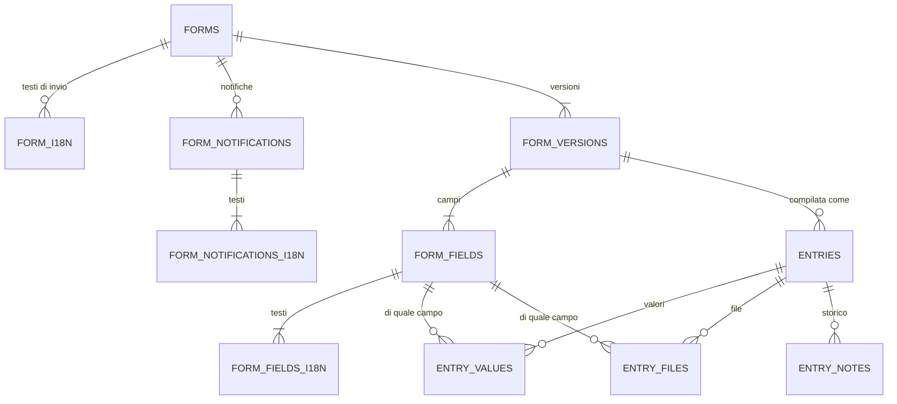

# Barrio Suite: piano di sviluppo (modulo Forms)

Riscrittura da zero del modulo Forms di `suite-barrio-prototipo`. Del prototipo si conservano le
funzionalità, non il codice. Il plugin nasce con il solo modulo Forms; gli altri moduli
arriveranno uno alla volta con la stessa struttura.

## Decisioni prese

| Tema | Decisione |
|---|---|
| Nome | `barrio-suite`, namespace `BarrioSuite\`, prefisso `barrio_`, tabelle `{prefix}barrio_*` |
| Convivenza | Gira accanto al prototipo (nessuna tabella, opzione o shortcode in comune) finché i siti non sono migrati. Sul prototipo va disattivato il modulo Forms |
| Requisiti | PHP 8.2+, WordPress 6.6+, MySQL 8.0.16+ o MariaDB 10.5+, InnoDB. Controllati all'attivazione con un messaggio chiaro |
| Database | Il centro del progetto: foreign key reali, CHECK, migrazioni versionate (vedi §2) |
| Email | `wp_mail()`, che usa il PHPMailer incluso in WordPress, con l'SMTP configurato tramite `phpmailer_init` e applicato a **tutte** le email del sito |
| Builder | React con `@wordpress/scripts` e `@wordpress/components` |
| GraphQL | Nomi invariati: `hbForm`, `hbForms`, `hbSubmitForm` e tutti i tipi `HB*`/`Hb*` |
| Plugin esterni | Nessuno è obbligatorio: senza WPGraphQL o WPML il plugin funziona e disattiva solo le funzioni che dipendono da loro (§4.1) |
| Traduzioni | Editor interno; le traduzioni si salvano nel database dentro ogni versione del form. Le lingue disponibili vengono da WPML; senza WPML il plugin lavora in una sola lingua |
| ACF | Il plugin non usa ACF |
| Privacy | Privacy by design e by default (art. 25 GDPR) in tutto il plugin: si raccoglie e si salva solo ciò che serve al form; ogni raccolta in più è un'opzione disattivata di default |
| Estensioni | Plugin separati (Mailchimp, MailUp, reCAPTCHA/Turnstile…) che usano hook e registri del core. Anche la migrazione dal prototipo è un'estensione: il core non contiene codice di compatibilità con il prototipo |

Principi: leggibilità prima dell'astuzia; ogni astrazione deve servire a qualcosa oggi; riusare
WordPress, WPGraphQL e WPML prima di scrivere codice nostro; una sola persona deve poter
mantenere tutto.

---

## 1. Problemi del prototipo da non ripetere

| Problema | Conseguenza |
|---|---|
| **`hbSubmitForm` salva in `/uploads` file in base64 con il nome scelto da chi invia, senza alcun controllo sull'estensione** | Chiunque, senza autenticazione, può caricare un file `.php` in una cartella pubblica (*remote code execution* sugli hosting che eseguono PHP in `/uploads`) |
| Logica di invio scritta due volte (AJAX e GraphQL) | Comportamenti diversi; la versione GraphQL non ha antispam |
| Campo obbligatorio controllato sul server senza la logica condizionale | Un campo obbligatorio nascosto blocca l'invio del form |
| Nonce scritto nell'HTML della pagina | Con una cache di pagina il nonce scade e l'invio fallisce |
| `$allowed_types` dichiarata ma mai usata; file in `/uploads` pubblico | Dati personali raggiungibili da un URL prevedibile |
| `page_break` ignorato dal frontend classico | Il multistep funziona solo in headless |
| `CREATE TABLE` e `SHOW COLUMNS` su `plugins_loaded` | Tre query DDL a **ogni** richiesta |
| CSS e JS inline generati da PHP | Non vanno in cache, non si possono testare |
| Integrazioni scritte dentro l'handler di invio | Per estendere bisogna modificare il core |
| Valori delle checkbox salvati come `"Label: true \| Label: false"` | Per leggerli serve una regex; le statistiche sono impossibili |
| Ogni registrazione salva il testo tradotto delle opzioni | La stessa scelta in due lingue risulta come due valori diversi |

---

## 2. Database (la fase più curata)

### 2.1 Regole di progettazione

1. **Motore e charset**: InnoDB esplicito; charset e collation di WordPress (`$wpdb->get_charset_collate()`, utf8mb4).
2. **Chiavi**: primary key surrogate `BIGINT UNSIGNED AUTO_INCREMENT` per le entità; primary key composta per le tabelle figlie pure (valori, traduzioni).
3. **Date**: `DATETIME` in **UTC**, scritte sempre da PHP (`gmdate()`). Niente `DEFAULT CURRENT_TIMESTAMP`, che dipende dal fuso della sessione MySQL. In visualizzazione si converte con `wp_date()`.
4. **Colonne o JSON**: una colonna per tutto ciò che il database deve interrogare, indicizzare o vincolare. Il tipo `JSON` (con CHECK che sia un oggetto) solo per la configurazione che si legge e si scrive sempre in blocco. Quel JSON viene validato in PHP con il JSON Schema di WordPress (`rest_validate_value_from_schema()`) prima di ogni scrittura.
5. **Foreign key sempre.** `CASCADE` solo verso figli puri senza risorse esterne; `RESTRICT` dove c'è un file su disco o un dato storico (le registrazioni). Così il database impedisce di cancellare una registrazione con file, o un form con registrazioni, senza passare dal codice del plugin.
6. **Nomi dei vincoli con il prefisso delle tabelle** (`{prefix}bff_version_fk`): in MySQL i nomi dei vincoli sono unici per database, quindi due installazioni WordPress nello stesso DB andrebbero in conflitto. Massimo 64 caratteri.
7. **CHECK per gli insiemi chiusi** (stati, flag, formati). WordPress disattiva la modalità rigorosa di MySQL, quindi senza CHECK un valore non valido verrebbe salvato senza errori. Gli insiemi aperti, come il tipo di campo che le estensioni possono ampliare, si validano in PHP.
8. **NULL significa "non applicabile o non noto".** Niente stringhe vuote usate come segnaposto.
9. **Nessuna foreign key verso le tabelle core di WordPress**: possono essere MyISAM sui siti vecchi e WordPress non conosce i nostri vincoli. `user_id` e `created_by` diventano NULL tramite l'hook `deleted_user`.
10. **Un solo punto di accesso**: solo i Repository usano `$wpdb`. Query sempre preparate (`%i` per gli identificatori). Ogni scrittura su più tabelle avviene in transazione.
11. **Registrazioni immutabili**: dopo l'invio cambiano solo `is_read` e le note.
12. **Migrazioni numerate**, solo in avanti, idempotenti e protette da un lock. Mai `dbDelta`, che non gestisce FOREIGN KEY e CHECK e non sa migrare i dati.

Ogni insieme chiuso esiste due volte, con gli stessi valori: come CHECK nel database e come
`enum` PHP (per esempio `FormStatus`). I test verificano che coincidano.

### 2.2 Modello

Concetto chiave: **versioni immutabili di ciò che il visitatore legge prima di inviare**, cioè i
campi e i loro testi. Ogni salvataggio dal builder crea una nuova versione dei campi. Ogni registrazione punta alla versione che l'utente
ha compilato. Nello stesso salvataggio la versione precedente viene eliminata se nessuna
registrazione la usa, quindi in pratica si accumulano versioni solo per i form modificati
dopo aver ricevuto risposte. Si ottiene:

- **Storia fedele**: etichette, opzioni e testo del consenso (anche tradotti) restano esattamente come li ha visti chi ha compilato. Vale come prova del consenso GDPR.
- **Nessun soft delete né diff dei campi**: un salvataggio inserisce righe nuove, non ne modifica di vecchie.
- **Blocco ottimistico gratuito**: il builder invia `base_version`. Se nel frattempo qualcuno ha salvato, la risposta è `409 Conflict` invece di sovrascrivere.

Testi di invio e di conferma e notifiche non si versionano: il visitatore vede i primi dopo l'invio,
e il rinvio di una notifica deve usare la configurazione corretta, non quella di allora. Si
sostituiscono a ogni salvataggio. Tutti i testi stanno in tabelle `_i18n` con una riga per lingua,
compresa la principale: nessun testo ha una lingua implicita.

`field_key` (per esempio `email`) è l'identità stabile di un campo **tra una versione e l'altra**:
la usano HTML, GraphQL, i merge tag e l'export CSV. Lo stesso campo, in due versioni diverse,
ha due `id` e la stessa `field_key`.



### 2.3 Schema (migrazione `0001`)

Il SQL è in [`modules/forms/migrations/0001_initial.php`](modules/forms/migrations/0001_initial.php), le regole d'uso
in [`docs/database.md`](docs/database.md). In sintesi:

```
forms                      id, title (interno), status active|closed|trash, created_at, updated_at
form_i18n                  (form_id, lang) → forms CASCADE
                           submit_label NOT NULL; success_message NULL = standard;
                           success_url NULL = resta sulla pagina, CHECK '^(/|https?://)'
form_notifications         id, form_id → forms CASCADE, name, is_enabled, recipients (template con merge tag),
                           reply_to NULL, attach_files, conditions JSON NULL = parte sempre,
                           position UNIQUE (form_id, position)
form_notifications_i18n    (notification_id, lang) → CASCADE; subject NOT NULL, heading NULL, body NOT NULL
form_versions              id, form_id → forms CASCADE, version UNIQUE (form_id, version), created_at, created_by
form_fields                id, version_id → CASCADE, field_key ^[a-z][a-z0-9_]*$, type (aperto, validato in PHP),
                           position, is_required, config JSON (dipende dal tipo e non si traduce),
                           conditions JSON NULL = sempre visibile; UNIQUE (version_id, field_key), (version_id, position)
form_fields_i18n           (field_id, lang) → CASCADE; label NOT NULL, placeholder NULL, error_message NULL,
                           options JSON {valore: etichetta} NULL
entries                    id, form_id + version_id → form_versions RESTRICT (FK composta), lang NOT NULL,
                           is_read, user_id NULL, source_url NULL senza query string né frammento, created_at
entry_values               (entry_id, field_id, position) → entries CASCADE, form_fields RESTRICT; value
entry_files                id, entry_id → RESTRICT, field_id → RESTRICT, stored_path UNIQUE, original_name,
                           mime_type, size_bytes > 0, created_at
entry_notes                id, entry_id → CASCADE, source, level info|success|error, message, user_id NULL, created_at
```

Su MariaDB `JSON` è un alias di `LONGTEXT` con `CHECK (JSON_VALID(...))` automatico; gli altri
vincoli funzionano allo stesso modo. Le colonne di identificatori e insiemi chiusi
(`status`, `field_key`, `type`, `lang`, `stored_path`, `source`, `level`) sono `utf8mb4_bin`: con la
collation di WordPress, che ignora le maiuscole, i CHECK accetterebbero `'Active'` o `'Email'`.
Le impostazioni globali (SMTP, retention, template email) **non** sono tabelle: sono opzioni
WordPress registrate con `register_setting()` e uno schema. Le impostazioni per form delle
integrazioni arrivano in fase 8 con una tabella propria (migrazione `0002`).

### 2.4 Catena delle cancellazioni (garantita dal database)

- **Form con registrazioni**: non si può eliminare. Il CASCADE verso le versioni incontra il RESTRICT di `entries`. Prima si cancellano le registrazioni dal plugin.
- **Registrazione con file**: non si può eliminare con un DELETE diretto (RESTRICT). Il Repository rimuove il file dal disco, poi la riga del file, poi la registrazione; valori e note seguono in CASCADE.
- **Versione usata da registrazioni**: non si può eliminare (RESTRICT); la pulizia delle versioni non usate non può sbagliare.
- **Campo con valori**: non si può eliminare (RESTRICT). Coerente con le versioni immutabili.
- **Form senza registrazioni**: testi, notifiche, versioni e campi seguono in CASCADE.

Due vincoli sono affidati al codice, perché il database non sa esprimerli, e sono coperti da test:
`entry_values.field_id` appartiene alla versione della registrazione (l'unico punto di scrittura
è `EntryRepository::create()`; nel database servirebbe una FK a tre colonne su ogni valore), e ogni
campo e ogni notifica hanno almeno una riga di testi (`FormRepository`; nessun vincolo SQL impone
l'esistenza di un figlio).

### 2.5 Query tipiche e indici

| Uso | Query | Indice |
|---|---|---|
| Render e invio | versione corrente: `WHERE form_id=? ORDER BY version DESC LIMIT 1`, poi campi e i18n | `form_version`, `version_position`, PK i18n |
| Elenco registrazioni | `WHERE form_id=? ORDER BY created_at DESC LIMIT 50 OFFSET ?` | `form_created` |
| Badge "non lette" | `COUNT(*) WHERE form_id=? AND is_read=0` | `form_read` |
| Dettaglio | valori e file `WHERE entry_id=?` con join su `form_fields` | PK `entry_values`, `entry` |
| Filtro per valore, statistiche opzioni | `WHERE field_id IN (…) AND value=?` / `GROUP BY value` | `field_value` |
| Ricerca GDPR per email | join `form_fields.type='email'` e `value=?` | `field_value` |
| Retention | `WHERE created_at < ? ORDER BY created_at LIMIT 200` (a blocchi; non `ORDER BY id`, che con molte righe vecchie richiede un filesort) | `created` |
| Export CSV | stream a blocchi di 500 su `form_created` | `form_created` |
| `hbForms.submissions` | `COUNT(*) … GROUP BY form_id` | `form_read` (copre la query) |

La definizione corrente del form (form, testi, notifiche, versione e campi: 7 query) si mette in `wp_cache` e si
invalida al salvataggio; con un object cache persistente il render non tocca il database.
Obiettivo dichiarato: ~100k registrazioni per sito senza degrado.
`// ponytail: la ricerca libera usa LIKE sui valori del form; oltre ~100k registrazioni si passa a un indice FULLTEXT su entry_values.value`.

### 2.6 Migrazioni e ciclo di vita

- `src/Database/Migrator.php` esegue i file `modules/<modulo>/migrations/NNNN_nome.php` in ordine e salva la versione raggiunta in un'opzione per modulo (`barrio_forms_db_version`). Gira all'attivazione e quando la versione è diversa: un confronto con un'opzione già caricata, nessuna query in più per richiesta.
- **Lock** con `GET_LOCK()` di MySQL contro le esecuzioni concorrenti: è atomico e il server lo rilascia da solo se la richiesta muore, quindi non serve una scadenza. (`add_option()` non va bene: usa `INSERT … ON DUPLICATE KEY UPDATE`, e due richieste possono "prendere" il lock entrambe.) Dopo aver preso il lock, la versione si rilegge dal database e non dalla cache delle opzioni. In caso di errore la versione **non** avanza, compare un avviso in admin e il plugin non accetta invii finché lo schema non è a posto.
- In MySQL il DDL non si annulla con un rollback: le migrazioni sono piccole e idempotenti (`IF NOT EXISTS`, controlli su `information_schema`).
- Le estensioni registrano le proprie migrazioni con lo stesso Migrator.
- **Multisite**: tabelle per sito tramite `$wpdb->prefix`; il Migrator parte su ogni sito alla prima richiesta, senza codice dedicato.
- **Disinstallazione**: elimina tabelle e file **solo** se è attiva l'opzione "Elimina i dati alla disinstallazione" (disattivata di default). Le tabelle si eliminano in ordine figli → padri. Arriva con la pagina Impostazioni che espone l'opzione: fino ad allora il comportamento di default (non eliminare nulla) è già quello giusto.

### 2.7 Pronta quando

- I test di integrazione dimostrano ogni vincolo: ogni FK (RESTRICT e CASCADE), ogni CHECK, ogni UNIQUE e la coincidenza tra `enum` PHP e CHECK. Girano su **MariaDB 10.5 e MySQL 8.0**.
- Repository e versioni funzionano: copia a ogni salvataggio, pulizia delle versioni non usate, `409` sul blocco ottimistico, transazioni annullate in caso di errore.
- Un comando `wp barrio forms seed --entries=100000` (WP-CLI, solo sviluppo) genera i dati; `EXPLAIN` sulle query del §2.5 usa gli indici previsti.
- Backup e ripristino con `mysqldump` e con un plugin di migrazione diffuso (per esempio WP Migrate o Duplicator), anche cambiando il prefisso delle tabelle: le FK sopravvivono.
- `docs/database.md` documenta schema, regole e catena delle cancellazioni.

---

## 3. Architettura

```
barrio-suite/
├── barrio-suite.php           # header, requisiti, autoloader PSR-4 (~10 righe, niente Composer in produzione)
├── uninstall.php
├── src/                       # core condiviso dai moduli futuri
│   ├── Plugin.php             # carica i moduli
│   ├── Requirements.php       # MySQL / MariaDB / InnoDB (PHP e WordPress li controlla WordPress dall'header)
│   ├── Database/Db.php        # transaction(), nomi delle tabelle
│   ├── Database/Migrator.php
│   └── Mail/Smtp.php          # phpmailer_init, email di test, password cifrata
├── modules/forms/
│   ├── migrations/0001_initial.php
│   ├── src/
│   │   ├── Module.php                     # boot(): aggancia gli hook
│   │   ├── Model/                         # readonly class: Form, FormVersion, Field, Entry + enum
│   │   ├── Repository/FormRepository.php  # unici a usare $wpdb
│   │   ├── Repository/EntryRepository.php
│   │   ├── FieldTypes.php                 # tipi core (il registro per le estensioni arriva in fase 8)
│   │   ├── Conditions.php                 # motore delle regole (campi, notifiche, integrazioni)
│   │   ├── Submission/                    # pipeline con antispam, FileStore
│   │   ├── Notifications.php, MergeTags.php
│   │   ├── Integrations.php               # registro delle estensioni
│   │   ├── I18n.php                       # lingue (da WPML se attivo, altrimenti solo quella del sito)
│   │   ├── Api/Rest*.php
│   │   ├── Api/GraphQL.php                # caricato solo se WPGraphQL è attivo
│   │   ├── Frontend/Render.php            # shortcode + render del blocco
│   │   ├── Privacy.php                    # retention, exporter/eraser
│   │   └── Admin.php
│   ├── assets/{frontend,block}/           # senza build: script module nativi e JS dell'editor scritto a mano
│   ├── assets/src/{builder,entries,settings}/   # React, con la build di @wordpress/scripts (dalla fase 4)
│   └── templates/email.php
├── tests/{Unit,Integration,fixtures}/
├── docs/{database.md,hooks.md}
├── composer.json              # solo strumenti di sviluppo
└── package.json               # @wordpress/scripts
```

### 3.1 Pipeline di invio (unica)

`Submission::process(Form $form, array $input, array $files, ?string $ip, ?int $user_id): Entry|WP_Error` viene chiamata da REST e da GraphQL.

1. Il form esiste ed è `active` (un form `closed` risponde con un messaggio dedicato).
2. Lingua: dall'input se è tra le lingue attive (§4.1), altrimenti la lingua principale. Senza WPML esiste solo la lingua del sito, che si salva comunque in `lang`. Versione: quella che il form ha mostrato (`_barrio_version`), se esiste ancora, altrimenti la corrente: con la cache di pagina il visitatore può aver letto una versione precedente, ed è quella che la registrazione deve provare.
3. Antispam: honeypot, token impostato via JS, limite di invii per IP (transient con l'hash dell'IP, che scade dopo pochi minuti e non finisce nella registrazione), poi il filtro `barrio_forms_spam_check` per i captcha delle estensioni.
4. Normalizzazione dei valori secondo il tipo di campo.
5. **Logica condizionale valutata sul server**: i campi nascosti si ignorano (non sono obbligatori e non si salvano).
6. Validazione per tipo (obbligatorio, email, numero, pattern, opzioni ammesse, file), poi il filtro `barrio_forms_validate`. Gli errori sono per campo e si restituiscono tutti insieme.
7. I file vanno nella cartella protetta (vedi §5); in una **transazione** si scrivono registrazione, valori e righe dei file. Se la transazione fallisce, i file appena scritti si eliminano.
8. `do_action('barrio_forms_after_submission', $entry, $form)`: notifiche e integrazioni sono listener. I loro errori finiscono nelle note della registrazione e **non** fanno fallire l'invio.

L'invio è sincrono, con timeout brevi verso i servizi esterni.
`// ponytail: notifiche e integrazioni sincrone; se la latenza dell'invio diventa un problema, coda con Action Scheduler`.

### 3.2 Endpoint REST (`barrio/v1`)

Pubblici: `GET /forms/{id}?lang=` (schema pubblico del form, usato da frontend e headless) e
`POST /forms/{id}/entries` (multipart, accetta file). Nessun nonce, quindi compatibili con la
cache di pagina.

Admin, ognuno con `permission_callback` sulle capability e argomenti validati con lo schema:
CRUD dei form (`PUT` con `base_version`), duplica, traduzioni per lingua, elenco registrazioni
(paginato, con ricerca e filtri), dettaglio, segna come letta, azioni di massa, export CSV in
streaming, download dei file, rinvio di una notifica, note, impostazioni SMTP (password in sola
scrittura) ed email di test.

### 3.3 Tipi di campo core

Gli stessi del prototipo, con gli stessi nomi per compatibilità con GraphQL e la migrazione:
`text`, `email`, `textarea`, `tel`, `number`, `datepicker`, `select`, `radio`, `checkbox`,
`file`, `page_break`. Più due nuovi:
- `consent`: checkbox singola con testo HTML limitato (link alla privacy policy), conservato nella versione come prova;
- `hidden`: valore fisso o preso da un parametro dell'URL.

Ogni tipo dichiara: lo **schema JSON della propria configurazione** (da cui il builder genera il
pannello e il server valida), `render()`, `normalize()` e `validate()`.

### 3.4 Frontend

- JS statico (vanilla, nessuna dipendenza, nessuna build) come *script module* di WordPress, e un CSS con *custom properties* che il tema può sovrascrivere. Si caricano solo quando nella pagina c'è un form (enqueue dal render, unico per blocco e shortcode).
- Validazione con la Constraint Validation API nativa, messaggi accessibili (`aria-invalid`, `aria-describedby`), **multistep vero** con validazione per step.
- La logica condizionale in JS e in PHP usa la **stessa suite di fixture** (`tests/fixtures/conditions.json`), eseguita da PHPUnit e da `node --test`: le due implementazioni non possono divergere.
- Blocco `barrio/form` (dinamico, `block.json`) e shortcode `[barrio_form id=""]` usano lo stesso render.
- Eventi DOM `barrio:success` e `barrio:error` (per GTM), più `window.barrioForms.beforeSubmit(fn)` per i captcha delle estensioni.

### 3.5 Admin

Menu "Barrio" (che ospiterà i moduli futuri) con le voci Form, Registrazioni e Impostazioni.

- **Builder** (React): campi con drag & drop accessibile (`@dnd-kit/sortable`), pannello delle proprietà generato dallo schema del tipo, logica condizionale, preset delle opzioni (nazioni, province: file JSON, estendibili con un filtro), impostazioni, notifiche, traduzioni, pannelli delle integrazioni, anteprima.
- **Registrazioni**: `@wordpress/dataviews` (la tabella del Site Editor: colonne a scelta, filtri, paginazione, azioni di massa), dettaglio con file e storico, export CSV.
- **Capability**: `barrio_manage_forms` (agli admin) e `barrio_manage_entries` (ad admin ed editor), assegnate all'attivazione. Sostituiscono il trucco del menu diverso per gli editor.

---

## 4. Riuso e dipendenze opzionali

WordPress è l'unico requisito. Del core usiamo:

| Da | Cosa usiamo |
|---|---|
| WordPress | REST API e validazione con JSON Schema (`rest_validate_value_from_schema`), Settings API, ruoli e capability, `wp_mail` + PHPMailer (`phpmailer_init`, `wp_mail_failed`), `wp_check_filetype_and_ext` e `wp_max_upload_size`, `wp_kses` per il consenso, strumenti Privacy (exporter/eraser), WP-Cron, transient, object cache, Block API, `@wordpress/components`, `dataviews`, `api-fetch`, `i18n`, WP-CLI per i comandi di sviluppo |
Stringhe dell'interfaccia in inglese con `__()` e traduzione `it_IT` (anche per il JS, con `wp_set_script_translations`).

### 4.1 Plugin esterni: tutti opzionali

| Plugin | Cosa abilita | Senza il plugin |
|---|---|---|
| WPGraphQL | `hbForm`, `hbForms`, `hbSubmitForm`, con `UserError` per gli errori e il debug di WPGraphQL al posto del campo `debug` (che resta nello schema, sempre `null`, per compatibilità) | Nessuno schema registrato e nessun errore; i frontend headless usano la REST API (`GET /forms/{id}`, `POST /forms/{id}/entries`) |
| WPML | Lingue attive e principale, lingua corrente, scheda Traduzioni del builder, lingua salvata nelle registrazioni | Una sola lingua: scheda Traduzioni nascosta, `lang` = lingua del sito, form ed email nella lingua del sito. Le traduzioni già salvate restano nel database e tornano attive se WPML viene riattivato |
| ACF | — | Nessun effetto: il plugin non lo usa |

Regole:
- Il core non chiama mai direttamente funzioni di un plugin esterno. Ogni integrazione sta in un solo file (`Api/GraphQL.php`, `I18n.php`), caricato o attivo solo se il plugin c'è.
- WPML si legge con i suoi filtri (`apply_filters('wpml_active_languages', null)` e simili). Senza WPML i filtri restituiscono il valore di default, quindi il passaggio a una sola lingua non richiede codice di rilevamento.
- L'elenco delle lingue passa dal filtro `barrio_forms_languages`: un'estensione può aggiungere Polylang senza toccare il core.
- Le email si inviano nella lingua di chi compila con `switch_to_locale()` di WordPress, che funziona anche senza WPML.
- La pagina Impostazioni mostra quali funzioni sono attive e quale plugin serve per le altre.

---

## 5. Sicurezza e affidabilità

- **File**: estensioni ammesse per singolo campo, intersecate con quelle consentite da WordPress; tipo MIME rilevato dal contenuto; dimensione massima; nome casuale (`random_bytes`) senza estensione eseguibile; cartella `uploads/barrio-forms-private/` con `.htaccess`, `web.config` e `index.php` (su Nginx la protezione viene dal nome casuale, e il plugin lo segnala); download solo tramite endpoint con capability. **Mai** file base64 scritti con il nome scelto dal client.
- Ogni rotta admin verifica le capability; ogni input passa dallo schema; ogni output è escapato; query sempre preparate.
- **SMTP**: password definita con una costante in `wp-config.php` oppure cifrata con `sodium` (con chiave derivata dai salt di WP); mai restituita dalla REST API.
- **Email**: header (From, Reply-To) ripuliti da a capo e validati; i merge tag nell'oggetto non possono iniettare header.
- **Export CSV**: le celle che iniziano con `= + - @` si neutralizzano (CSV injection).
- **Affidabilità**: la registrazione si salva prima di qualsiasi effetto collaterale; gli errori di notifiche e integrazioni restano nelle note; ogni notifica si può rinviare.
- **Privacy by default**: nessun IP, user agent o referrer salvato; URL della pagina di invio senza query string né frammento (vincolo `be_url_chk`); retention configurabile; registrazione degli strumenti Privacy di WordPress con la ricerca per email tramite l'indice `field_value`. Ogni raccolta in più arriva come opzione disattivata di default.

---

## 6. API per le estensioni (`docs/hooks.md`)

Le estensioni sono plugin separati che si agganciano a `barrio_forms_loaded`.

- **Hook della pipeline**: `barrio_forms_spam_check`, `barrio_forms_validate`, `barrio_forms_entry_data`, `barrio_forms_after_submission`, `barrio_forms_notification`, `barrio_forms_rest_response`.
- **Tipi di campo**: `barrio_forms_register_field_type($slug, $definition)`.
- **Integrazioni** (il concetto di *feed* di Gravity Forms): impostazioni globali e per form dichiarate come schema (il builder le mostra da solo; quelle marcate `translatable` compaiono nella scheda Traduzioni), un callback `process()` chiamato solo se la condizione del feed è vera, esito scritto nelle note.
- **Database**: le estensioni registrano le proprie migrazioni con il Migrator.

```php
add_action('barrio_forms_loaded', function () {
    barrio_forms_register_integration('mailchimp', [
        'label'           => 'Mailchimp',
        'global_settings' => ['api_key' => ['type' => 'string', 'format' => 'password']],
        'form_settings'   => [
            'list_id'     => ['type' => 'string', 'translatable' => true],
            'email_field' => ['type' => 'string', 'format' => 'field:email'],
            'merge'       => ['type' => 'object', 'format' => 'field_map'],
        ],
        'process' => fn (Entry $entry, Form $form, array $config, array $global): true|WP_Error => /* … */,
    ]);
});
```

---

## 7. Fasi

Ogni fase si chiude con test verdi e un plugin installabile.

| # | Fase | Pronta quando |
|---|---|---|
| 0 | **Scheletro**: repository git, header, controllo dei requisiti, autoloader, Migrator, `wp-env` (MariaDB) in locale, MySQL 8.0 e MariaDB 10.5 in CI, PHPCS (WPCS), PHPStan livello 8 con `phpstan-wordpress`, PHPUnit, `@wordpress/scripts` (ESLint, Prettier, stylelint), CI | Il plugin si attiva su un WordPress senza altri plugin e accanto al prototipo; senza i requisiti si rifiuta di attivarsi con un messaggio chiaro; CI verde, con e senza WPGraphQL |
| 1 | **Database** (§2) | Criteri del §2.7 |
| 2 | **Pipeline e frontend**: tipi core, `Conditions` PHP+JS, validazione, FileStore, antispam, REST pubblico, render, blocco e shortcode, multistep | Un form creato via WP-CLI/JSON si invia, rispetta la logica condizionale e respinge file non ammessi; fixture condivise verdi in PHP e JS; ESLint e stylelint entrano in CI (prima non c'erano file da controllare) |
| 3 | **Email**: impostazioni SMTP, email di test, notifiche multiple, merge tag (`{{campo}}`, `{{all_fields}}`…), notifiche condizionali, allegati per notifica, template globale (logo, colori, footer) | Email ricevute via SMTP; i fallimenti finiscono nelle note e si possono rinviare |
| 4 | **Builder React** | Si crea un form completo senza toccare il JSON; il salvataggio concorrente dà `409` |
| 5 | **Registrazioni**: DataViews, dettaglio, letto/non letto, azioni di massa, CSV, file, note, capability per gli editor | Un editor gestisce le registrazioni senza accedere al builder |
| 6 | **Privacy**: retention, exporter/eraser | Le richieste di accesso e cancellazione dei dati dagli strumenti di WordPress trovano e cancellano le registrazioni |
| 7 | **Traduzioni**: scheda Traduzioni del builder, lingue da WPML, email nella lingua di chi compila | Form ed email in inglese su un sito WPML; le statistiche aggregano le lingue. Senza WPML la scheda non compare, tutto funziona in una lingua e le traduzioni salvate restano nel database |
| 8 | **API estensioni** e documentazione, tabella delle impostazioni per form delle integrazioni (migrazione `0002`), **estensione Mailchimp** e **estensione captcha** come prove | Mailchimp e captcha funzionano senza modificare il core |
| 9 | **GraphQL** con i nomi del prototipo, sulla pipeline unica (file base64 accettati ma passati dal FileStore) | Uno snapshot dei test confronta lo schema con quello del prototipo; un frontend Next.js esistente funziona senza modifiche; senza WPGraphQL il plugin non registra nulla e non dà errori |
| 10 | **Migrazione dal prototipo**, come estensione separata da disattivare a migrazione finita (comando WP-CLI con prova a vuoto): form con lo **stesso ID**; v1 "archivio" con anche i campi presenti solo nelle vecchie registrazioni, v2 = definizione attuale; checkbox `"Label: true\|…"` → righe; file spostati nella cartella protetta; IP, user agent e referrer del prototipo non si importano (privacy by default); `_page_*` → `source_url` senza query string; Mailjet → SMTP (`in-v3.mailjet.com:587`); impostazioni MailUp e Mailchimp conservate per le estensioni; alias `[suite_barrio_form]`/`[wpb_form]` se liberi | Un sito reale passa al nuovo plugin con conteggi verificati prima e dopo |

Fuori dal core e da sviluppare come estensioni: MailUp, Mailchimp, reCAPTCHA/Turnstile, migrazione dal prototipo.
Eliminato: Mailjet API (sostituito dall'SMTP).

## 8. Punti da verificare durante lo sviluppo

- **Convivenza dello schema GraphQL**: il `graphql.php` del prototipo registra i tipi `hb*` anche con il modulo Forms disattivato. Va verificato come si comporta WPGraphQL con due registrazioni dello stesso nome; se serve, una riga nel prototipo che salti la registrazione quando `BARRIO_SUITE_VERSION` è definita.
- **Test con WPML**: WPML è a pagamento e non si installa in CI. I test simulano i suoi filtri (sono l'unico punto di contatto); in più serve una prova manuale su un sito reale prima di chiudere la fase 7.
- **Hosting dei clienti**: verificare all'attivazione su un sito reale di ognuno (versione di MySQL/MariaDB e InnoDB).
- **Limite di invii per IP** (fase 2): usa `REMOTE_ADDR`. Dietro un proxy che non lo riscrive (Cloudflare senza `mod_remoteip`), o con un frontend headless che invia dal proprio server, tutti gli invii hanno lo stesso IP e il limite (10 ogni 10 minuti) vale per l'intero sito. Verificare sugli hosting dei clienti; se serve, un filtro sull'IP o sul limite.
- **Download dei file** (fase 5): il controllo di WordPress sul contenuto è severo per i tipi `application/*` ma lascia passare come "non verificati" gli altri (un `.pdf` che contiene testo). I file non si eseguono (nome casuale senza estensione, cartella protetta), ma l'endpoint di download deve rispondere con `Content-Disposition: attachment` e `X-Content-Type-Options: nosniff`.
- **Namespace REST condiviso**: il prototipo usa già `barrio/v1` (cookie banner, accessibilità: `/config`, `/scan`, `/consent-log`, `/accessibility`…). Le rotte dei form (`/forms/…`) non collidono; quando si porteranno quei moduli bisognerà scegliere rotte diverse o disattivarli nel prototipo.
