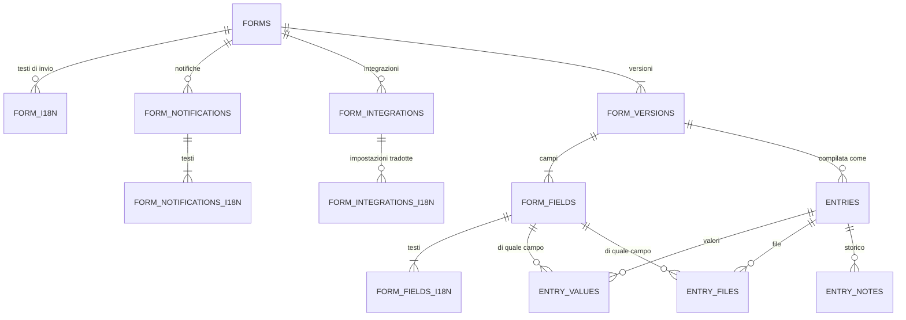

# Database del modulo Forms

Lo schema è in [`modules/forms/migrations/0001_initial.php`](../modules/forms/migrations/0001_initial.php), più le
impostazioni per form delle integrazioni in [`0003_integrations.php`](../modules/forms/migrations/0003_integrations.php)
(la `0004` toglie `form_versions.created_by` ed `entries.user_id`, che nessuno leggeva)
(la `0002` assegna le capability): quella è la fonte di verità, qui ci sono le ragioni e le regole per usarlo.
I test che dimostrano ogni vincolo sono in [`tests/Integration/SchemaTest.php`](../tests/Integration/SchemaTest.php)
e girano in CI su MySQL 8.0 e MariaDB 10.5.

## Regole

- **InnoDB, charset di WordPress**, date `DATETIME` in UTC scritte da PHP (`gmdate()`), mai `DEFAULT CURRENT_TIMESTAMP`.
- **Identificatori in `utf8mb4_bin`** (`status`, `field_key`, `type`, `slug`, `lang`, `stored_path`, `source`, `level`): con la
  collation di WordPress, che ignora le maiuscole, `CHECK (status IN ('active', …))` accetterebbe `'Active'` e
  `REGEXP '^[a-z]…'` accetterebbe `'Email'`. Non `ascii_bin`: con due charset nella stessa tabella `wpdb` la tratta
  come ASCII e rifiuta qualsiasi query scritta a mano che contenga testo non ASCII.
- **Una colonna per ciò che si interroga, JSON (con `CHECK JSON_TYPE = 'OBJECT'`) per la configurazione** letta e
  scritta in blocco: `config` e `conditions` dei campi, `conditions` delle notifiche, `options` dei testi, `settings`
  e `conditions` delle integrazioni. Quando il contenuto lo definisce un'estensione (il tipo di un campo, le
  impostazioni di un'integrazione) si valida in PHP con lo schema che l'estensione registra. In PHP il
  JSON vuoto si scrive come `{}`: `json_encode([])` darebbe `[]`, che il CHECK rifiuta. L'ordine delle chiavi di un
  oggetto JSON non si conserva (MySQL le riordina): ciò che ha un ordine è una lista. Per questo le etichette delle
  scelte (`options`, `{valore: etichetta}`) seguono l'ordine dei valori in `config`.
- **Testi in tabelle `_i18n`, una riga per lingua compresa la principale**: nessun testo ha una lingua implicita, e
  cambiare la lingua principale in WPML non rende sbagliato nessun dato. NULL in una colonna facoltativa vuol dire
  "valore standard" (per esempio il messaggio di errore di WordPress tradotto), mai "eredita da un'altra lingua".
  Che ogni campo e ogni notifica abbiano almeno una riga di testi lo garantisce `FormRepository`: nessun vincolo SQL
  impone l'esistenza di un figlio.
- **Privacy by default**: si salva solo ciò che serve al form. Niente IP, user agent, referrer o titolo della pagina;
  `source_url` è senza query string e frammento, che possono contenere dati personali o identificativi di
  tracciamento (`be_url_chk`). Una raccolta in più, se servirà, arriverà come opzione disattivata di default.
- **Foreign key sempre**: `CASCADE` verso i figli puri, `RESTRICT` dove c'è un file su disco o un dato storico.
  Nessuna FK verso le tabelle di WordPress: `entry_notes.user_id` si azzera sull'hook `deleted_user`.
- **Insiemi chiusi due volte**: CHECK nel database ed `enum` PHP (`FormStatus`, `NoteLevel`); un test verifica che coincidano.
- **Nomi dei vincoli con il prefisso delle tabelle** (`wp_bf_status_chk`), perché in MySQL sono unici per database.
  MySQL accetta nomi fino a 64 caratteri, e il più lungo è quello della tabella `{prefisso}barrio_form_notifications_i18n`:
  il prefisso può avere al massimo 34 caratteri.
- **Solo i Repository scrivono SQL**, sempre con `$wpdb->prepare()` (`%i` per i nomi), e passano da `Db`, che
  trasforma ogni errore del database in un'eccezione.
- **Ogni scrittura su più tabelle è in `Db::transaction()`**. Dentro un'altra transazione, o con autocommit spento
  come nei test di WordPress, usa un savepoint: `START TRANSACTION` confermerebbe la transazione già aperta.
- **Registrazioni immutabili**: dopo l'invio cambiano solo `is_read` e le note.

## Cosa si versiona

Si versiona ciò che il visitatore legge prima di inviare: i campi e i loro testi (`form_fields`, `form_fields_i18n`).
Ogni registrazione punta alla versione compilata, quindi etichette, scelte e testo del consenso restano esattamente
come erano, in tutte le lingue: vale come prova del consenso.

Il resto è configurazione corrente e si sostituisce a ogni salvataggio: i testi di invio e di conferma
(`form_i18n`), che il visitatore vede dopo l'invio, le notifiche, il cui rinvio deve usare la configurazione
corretta (un destinatario sistemato), non quella di allora, e le integrazioni (`form_integrations`): una per
estensione e per form, con le impostazioni traducibili in `form_integrations_i18n`, una riga per lingua solo se
ne ha. Lo `slug` è aperto come il tipo dei campi; le righe di un'estensione disattivata restano e tornano valide
quando la si riattiva.

`FormRepository::save()`:

1. `SELECT … FOR UPDATE` sulla riga del form: i salvataggi dello stesso form avvengono uno alla volta.
2. Se la versione corrente non è quella da cui è partito chi salva, risponde `409` senza scrivere nulla. Il numero
   di versione è il blocco ottimistico, quindi ogni salvataggio crea una versione, anche se cambiano solo testi o notifiche.
3. Sostituisce testi del form, notifiche e integrazioni (le loro traduzioni seguono in CASCADE).
4. Inserisce la versione `corrente + 1` con campi e testi.
5. `DELETE IGNORE` delle versioni precedenti: quelle usate da registrazioni restano, perché il RESTRICT di
   `entries` fa fallire la loro cancellazione e `IGNORE` passa alla riga successiva. Così è il database a decidere
   quali versioni sono in uso, anche con un invio in corso nello stesso momento.

Un invio che arriva con una versione appena eliminata (form salvato mentre l'utente compilava, senza altre
registrazioni) viene rifiutato dalla FK: nessun dato incoerente, l'utente ricarica la pagina.

`field_key` identifica lo stesso campo tra le versioni (HTML, GraphQL, merge tag, export); l'`id` cambia a ogni versione.

Form, testi, notifiche, integrazioni e versione corrente si leggono con 9 query e restano nella object cache
(gruppo `barrio_forms_{versione del plugin}`, così dopo un aggiornamento non torna un oggetto vecchio) fino al
salvataggio successivo, al massimo per un giorno.

## Catena delle cancellazioni

| Cosa | Comportamento |
|---|---|
| Form con registrazioni | Bloccato (RESTRICT di `entries` sulla versione). `FormRepository::delete()` risponde `409`: prima si cancellano le registrazioni |
| Form senza registrazioni | Testi, notifiche, integrazioni, versioni, campi e relative traduzioni seguono in CASCADE |
| Registrazione con file | Bloccata con un DELETE diretto (`befi_entry_fk`). `EntryRepository::delete()` elimina i file dal disco, poi le righe dei file, poi la registrazione; valori e note seguono in CASCADE |
| Versione usata da registrazioni | Bloccata (`be_version_fk`) |
| Campo con valori o file | Bloccato (`bev_field_fk`, `befi_field_fk`) |

Vincoli affidati al codice, perché il database non sa esprimerli:

- i valori e i file di una registrazione appartengono a campi della sua versione: lo controlla l'unico punto di
  scrittura, `EntryRepository::create()` (test in `EntryRepositoryTest`); nel database servirebbe una FK a tre
  colonne su ogni valore;
- ogni campo e ogni notifica hanno almeno una riga di testi: `FormRepository` (test in `FormRepositoryTest`);
- le impostazioni di un'integrazione rispettano lo schema della sua estensione, e ogni integrazione compare una
  volta per form (anche la UNIQUE `form_slug` lo vieta, ma con un errore del database): `FormRepository` con
  `Integrations::check()` (test in `IntegrationsTest`).

## Query e indici

Misurate con 100.000 registrazioni (5 form, 2 versioni ciascuno, testi in italiano e inglese, ~700.000 valori),
generate da `npm run seed -- --entries=100000`. `EXPLAIN` su MariaDB 12.3:

| Uso | Query | Indice usato |
|---|---|---|
| Versione corrente | `forms` JOIN `form_versions … ORDER BY version DESC LIMIT 1` | `PRIMARY` + `form_version` (coprente) |
| Testi del form | `form_i18n WHERE form_id = ?` | `PRIMARY` |
| Notifiche e testi | `WHERE form_id = ? ORDER BY position`, JOIN `form_notifications_i18n` | `form_position`, `PRIMARY` |
| Integrazioni e impostazioni tradotte | `WHERE form_id = ? ORDER BY id`, JOIN `form_integrations_i18n` | `form_slug` (poche righe per form), `PRIMARY` |
| Campi e testi | `WHERE version_id = ? ORDER BY position`, JOIN `form_fields_i18n` | `version_position`, `PRIMARY` |
| Elenco registrazioni | `WHERE form_id = ? ORDER BY created_at DESC, id DESC LIMIT 20 OFFSET ?` | `form_created`, senza filesort |
| Ricerca libera | `EXISTS (SELECT 1 FROM entry_values WHERE entry_id = e.id AND value LIKE '%…%')` | `PRIMARY` di `entry_values` per registrazione: ~100 ms a query su 20k registrazioni (il totale e la pagina sono due query) |
| Ordinamento per campo | `LEFT JOIN entry_values` sui `field_id` della chiave in tutte le versioni, `position = 0`, `ORDER BY value` | `PRIMARY` + filesort, ~130 ms su 20k registrazioni |
| Badge "non lette" | `COUNT(*) WHERE form_id = ? AND is_read = 0` | `form_read` (coprente) |
| Dettaglio | `entry_values WHERE entry_id = ?` JOIN `form_fields` | `PRIMARY`, `PRIMARY` |
| Filtro per valore | `WHERE field_id IN (…) AND value = ?` | `field_value` |
| Statistiche opzioni | `WHERE field_id IN (…) GROUP BY value` | `field_value` + tabella temporanea (~20k righe per campo) |
| Ricerca GDPR per email (`EntryRepository::by_email()`) | `form_fields WHERE type = 'email'` JOIN `entry_values … value = ?` | scansione di `form_fields` (poche righe) + `field_value` |
| Retention (`EntryRepository::delete_older_than()`) | `WHERE created_at < ? ORDER BY created_at LIMIT 200` | `created` (coprente). Non `ORDER BY id`: con molte righe vecchie richiede un filesort su tutte |
| Export CSV | `WHERE form_id = ? AND (created_at > ? OR (created_at = ? AND id > ?)) ORDER BY created_at, id LIMIT 500` | `form_created`; 20k righe (6 MB) in ~1 s via HTTP |
| Conteggi per form | `GROUP BY form_id` | `form_read` (coprente, il più piccolo) |
| Lingue dei form nell'elenco (`FormRepository::all()`) | `UNION` dei testi del form, delle notifiche e dei campi della versione corrente (`MAX(version)` per form) | scansione di `form_i18n` e delle notifiche (poche righe), `form_version` e `version_position` (coprenti), poi `PRIMARY` |

Spazio occupato con quei dati: `entries` 9,5 MB + 16 MB di indici, `entry_values` 52 MB + 43 MB di indici. Le
definizioni sono trascurabili: una versione con 10 campi in 2 lingue sono 31 righe, e restano solo le versioni usate.

### Perché non uno snapshot JSON per registrazione

Alternativa valutata: definizioni modificabili senza versioni e, in ogni registrazione, un JSON con tipo, etichetta,
valore ed etichette delle scelte di ogni campo. Misurata sugli stessi dati (MariaDB 12.3, buffer pool di 128 MB,
etichette italiane realistiche):

| Operazione | Versioni + `entry_values` | Snapshot JSON |
|---|---|---|
| Spazio | 124 MB | 133 MB (il 78% del JSON sono etichette e chiavi ripetute) |
| Elenco, prima pagina | 0,2 ms | 0,1 ms |
| Filtro per valore, totale per la paginazione | 1,2 ms | 240–300 ms |
| Statistiche di una checkbox | 69 ms | ~390 ms (`JSON_TABLE` non esiste su MariaDB 10.5) |
| Ricerca GDPR per email, tutti i form | 0,1 ms | ~850 ms |
| Lettura completa per l'export (20k) | 75 ms | 310 ms |

Lo storico è fedele in entrambi i modelli, ma lo snapshot lo copia in ogni riga e trasforma in scansioni complete le
query sui valori, che crescono in modo lineare (~9 s per la ricerca GDPR a 1 milione di registrazioni). Un indice sui
valori dentro il JSON esiste solo su MySQL (indici multi-valore), non su MariaDB.

## Operazioni

- **Backup e ripristino**: `mysqldump` (e `wp db export`) salva FK e CHECK; nel ripristino i controlli FK sono
  disattivati, quindi l'ordine delle tabelle non conta. Provato ripristinando il dump con il prefisso cambiato
  (`wp_` → `nx_`) nello stesso database: 12 FK e 18 CHECK per prefisso, senza conflitti di nomi e funzionanti. Era
  prima della migrazione `0003`, che aggiunge 2 FK e 6 CHECK con gli stessi nomi a prefisso (14 FK e 24 CHECK).
- **Cambio di prefisso con `RENAME TABLE`** (lo fanno alcuni plugin): InnoDB aggiorna da solo i riferimenti delle FK,
  ma i nomi dei vincoli restano con il prefisso vecchio. Funziona; crea problemi solo se nello stesso database si
  installa un altro WordPress con il prefisso vecchio, perché i nomi dei vincoli andrebbero in conflitto.
- **Plugin di migrazione** (WP Migrate, Duplicator): da provare a mano su un sito reale prima del passaggio in produzione.
- **Multisite**: tabelle per sito con `$wpdb->prefix`; il Migrator parte su ogni sito alla prima richiesta.
  L'azzeramento degli utenti cancellati riguarda solo il sito corrente.
- **Migrazioni che non toccano lo schema**: la `0002` assegna le capability ai ruoli (anche i ruoli sono dati del
  sito, nell'opzione `{prefisso}user_roles`). Passa dal Migrator per lo stesso motivo delle tabelle: arriva una
  volta sola su ogni sito, anche sui siti di un multisite con il plugin attivato in rete, dove l'hook di
  attivazione parte una volta sola.
- **Utenti cancellati**: `deleted_user` azzera `entry_notes.user_id`.

## Modulo SEO

Una sola tabella, `redirects` ([`modules/seo/migrations/0001_redirects.php`](../modules/seo/migrations/0001_redirects.php);
la `0002` assegna `barrio_manage_seo` agli amministratori e `barrio_edit_seo` anche agli editor), con le regole
sopra. I suoi vincoli sono in `SchemaTest` come quelli dei form. Il resto dei dati SEO non ha tabelle: i meta
`_barrio_seo_*` di contenuti e termini, registrati con `register_post_meta` e `register_term_meta` e validati dalla
REST del core, e l'opzione `barrio_seo` (`modules/seo/src/Settings.php`). L'opzione è in autoload perché ogni pagina
del sito la legge intera: arriva con le altre opzioni, senza query in più.

- **`source`** è il percorso senza dominio, con la query string, in `utf8mb4_bin` perché gli URL distinguono le
  maiuscole: `/` all'inizio e nessuna `/` finale prima della query, tranne la radice (`br_source_chk`), così la
  UNIQUE non lascia passare `/a` e `/a/`. `VARCHAR(768)` sono i 3072 byte massimi di una chiave InnoDB.
- **`code`** è uno dei codici dell'enum `RedirectCode` (`br_code_chk`); un 410 e solo lui non ha `target`
  (`br_target_chk`), che è un percorso o un URL `http(s)` (`br_url_chk`).
- **`is_auto`** segna i redirect creati dal cambio di URL di un contenuto o di un termine; resta anche se poi si
  modificano a mano.
- Solo `RedirectRepository` legge e scrive la tabella; una sorgente già usata diventa un'eccezione di `Db`. La
  tabella di SEO → Redirect cerca anche nella sorgente senza distinguere le maiuscole
  (`COLLATE utf8mb4_unicode_ci` nella query).

## Modulo Ordinamento

Nessuna tabella. L'ordine dei contenuti è `menu_order` di `wp_posts`, il campo del core che usano già temi, menu e
WPGraphQL; quello dei termini è il meta `_barrio_order` (un intero), perché WordPress non ha un ordine dei termini.
Le posizioni partono da 1 e sono quelle dell'elenco intero, con i genitori prima dei figli: anche una query senza
gerarchia esce nell'ordine dell'albero, e un contenuto nuovo (`menu_order` 0) va in cima. Solo `OrderRepository` le
scrive:

- **Contenuti**: un solo `UPDATE … SET menu_order = FIELD(ID, …)`, atomico anche dove `wp_posts` non è InnoDB, che
  non tocca `post_modified` e non fa partire gli hook di salvataggio. Poi `clean_post_cache()`.
- **Termini**: `DELETE` e `INSERT` dei meta in una transazione. Dove `termmeta` non è InnoDB un errore tra le due
  lascia quei termini senza ordine (in fondo, per nome), non con un ordine a metà.

Nelle query l'ordine è un `LEFT JOIN` su `termmeta` (`terms_clauses`) e `orderby` di `WP_Query` (`pre_get_posts`):
nessuna query in più. L'opzione `barrio_ordering` (in autoload, la leggono le query del sito) elenca i tipi e le
tassonomie in ordine manuale; spegnerli lascia `menu_order` e i meta. La disinstallazione con i dati elimina i meta
`_barrio_order`; `menu_order` resta, perché è del core.
